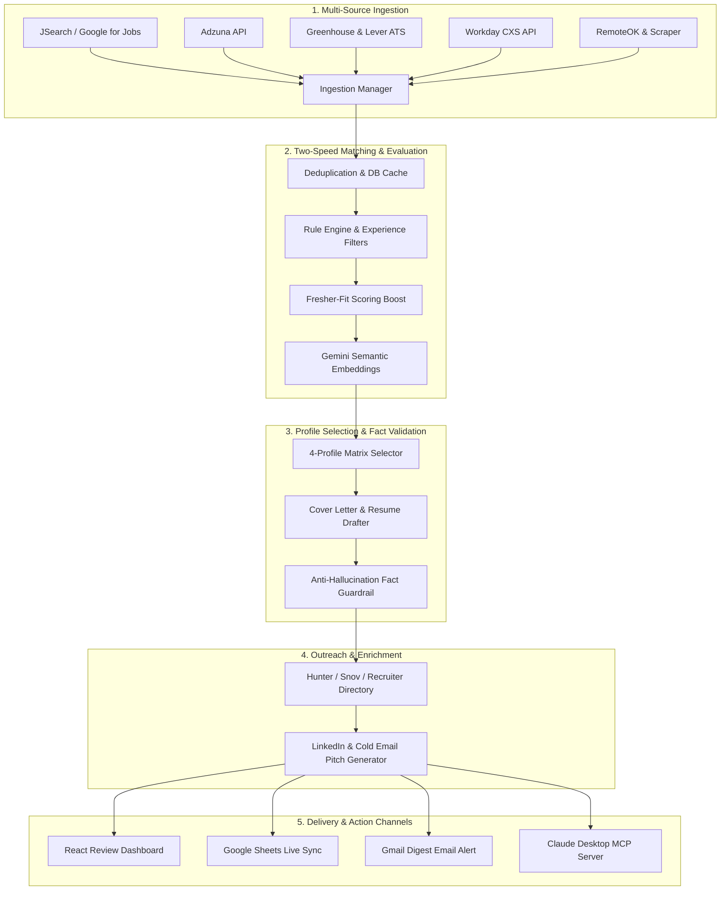

<div align="center">

# 🚀 AI Job Finder & Automated Application Drafter

### *Autonomous Multi-Board Job Aggregator, Anti-Hallucination Resume Matrix & Recruiter Outreach Engine*

[](https://python.org)
[](https://fastapi.tiangolo.com)
[](https://vitejs.dev)
[](https://ai.google.dev)
[](https://aws.amazon.com)
[-8A2BE2)](https://modelcontextprotocol.io)
[](LICENSE)
[](CONTRIBUTING.md)

<p align="center">
  <b>Stop wasting hundreds of hours doom-scrolling job boards.</b><br/>
  An intelligent, fact-grounded job search engine that continuously scans 7+ job feeds, scores fresher/early-career fit, selects the highest-matching variant from your <b>4-Profile Matrix</b>, drafts validated cover letters with <b>zero hallucinated claims</b>, and prepares high-conversion cold emails for real recruiters.
</p>

[Key Features](#-key-features) • [System Architecture](#-system-architecture) • [Job Aggregation Sources](#-job-aggregation-sources) • [Quickstart Guide](#-quickstart-guide) • [AWS Serverless Deploy](#-aws-serverless-cron-deployment) • [MCP Server](#-claude-desktop--mcp-server)

---

</div>

## 📑 Table of Contents

- [✨ Why AI Job Finder?](#-why-ai-job-finder)
- [🔥 Key Features](#-key-features)
  - [1. Broad Multi-Source Ingestion](#1-broad-multi-source-ingestion-7-sources)
  - [2. Fresher-Targeted Scoring Engine](#2-fresher-targeted-scoring-engine)
  - [3. 4-Curated Profiles Matrix](#3-4-curated-profiles-matrix)
  - [4. Anti-Hallucination Claim Validation](#4-anti-hallucination-claim-validation-pass)
  - [5. Cold Outreach & Recruiter Enrichment](#5-cold-outreach--recruiter-enrichment)
  - [6. Human-in-the-Loop Review Dashboard](#6-human-in-the-loop-review-dashboard)
- [🏗️ System Architecture](#-system-architecture)
- [📡 Job Aggregation Sources](#-job-aggregation-sources)
- [⚡ Quickstart Guide](#-quickstart-guide)
  - [Prerequisites](#prerequisites)
  - [1. Clone \& Environment Setup](#1-clone--environment-setup)
  - [2. Candidate Profile Setup](#2-candidate-profile-setup)
  - [3. Run Backend (FastAPI)](#3-run-backend-fastapi)
  - [4. Run Frontend (React + Vite)](#4-run-frontend-react--vite)
- [🤖 Claude Desktop & MCP Integration](#-claude-desktop--mcp-server)
- [☁️ AWS Serverless Cron Deployment](#-aws-serverless-cron-deployment)
- [📊 Google Sheets & Email Alerts Sync](#-google-sheets--email-alerts-sync)
- [🧪 Automated Test Suite](#-automated-test-suite)
- [📁 Project Layout](#-project-layout)
- [🔒 Security & Ethics Policy](#-security--ethics-policy)
- [🤝 Contributing](#-contributing)
- [📄 License](#-license)

---

## ✨ Why AI Job Finder?

Most generic job bots either spam LinkedIn with robotic applications that get your account banned, or hallucinate skills on your resume that lead to immediate rejection during technical interviews.

**AI Job Finder takes a radically different approach:**
1. **Zero Silent Submissions**: Humans stay in total control. The platform aggregates, ranks, validates, and drafts. You review with 1 click and apply directly on the verified company portal.
2. **Guaranteed Anti-Hallucination**: Generated cover letters and bullet points undergo strict verification against your authentic profile. Any tool, metric, or company you never worked with is automatically purged.
3. **Optimized for Early-Career & Freshers**: Specifically filters and prioritizes entry-level roles (`GET`, `SDE 1`, `Associate Software Engineer`, `Junior Developer`, `Graduate Engineer Trainee`) while downranking roles requiring 3+ YOE.

---

## 🔥 Key Features

### 1. Broad Multi-Source Ingestion (7+ Sources)
Scans constantly across aggregators, enterprise applicant tracking systems (ATS), and remote feeds:
- **JSearch (Google for Jobs)**: Pulls postings across LinkedIn, Indeed, Glassdoor, Naukri, and verified company career pages.
- **Adzuna API**: Comprehensive global coverage with deep India tech job indexing.
- **Greenhouse & Lever ATS APIs**: Direct real-time feeds from over 110+ fast-growing startups and unicorns (Stripe, Figma, Razorpay, Swiggy, Postman, etc.).
- **Workday CXS API**: Direct ingestion across Fortune 500 portals (Nvidia, Adobe, Cisco, Mastercard, Visa, etc.).
- **RemoteOK API**: Global remote engineering roles.
- **Schema.org Microdata Scraper**: Built-in compliant fallback scraper with domain throttling.

### 2. Fresher-Targeted Scoring Engine
- **Semantic & Cosine Matching**: Uses Google Gemini embeddings for deep semantic relevance between job descriptions and candidate skills.
- **Fresher-Fit Priority Boost**: Explicit fresher designations (`GET`, `SDE-1`, `Associate`) receive an automatic **+15% fit boost**. JDs mentioning `0-1 years` or `freshers welcome` receive an extra **+10% boost**.
- **Experience Penalty Guard**: Senior / Staff / Principal postings are detected and deprioritized or filtered automatically.

### 3. 4-Curated Profiles Matrix
Maintains 4 tailored variants of your authentic professional identity:
| Profile Variant | Core Focus | Primary Tech Stack |
| :--- | :--- | :--- |
| **1. Backend Software Engineer** | APIs, High Concurrency, DBs | Python, FastAPI, PostgreSQL, Redis, Docker |
| **2. General SDE / Fresher** | DSA, CS Fundamentals, Problem Solving | C++, Java, Python, OOP, System Design Basics |
| **3. GenAI & ML Engineer** | LLMs, Vector DBs, Agents, Fine-Tuning | PyTorch, Gemini API, RAG, LangChain, Embeddings |
| **4. Full-Stack Engineer** | Reactive UI, REST APIs, End-to-End | React, TypeScript, Tailwind, FastAPI, Node.js |

The engine evaluates each job description against all 4 profiles and automatically selects the highest-scoring match.

### 4. Anti-Hallucination Claim Validation Pass
- Deconstructs every AI-generated cover letter paragraph and resume bullet.
- Validates every technical skill, metric, and timeline against your injected `my_profile.json`.
- Strips any fabricated claims and flags low-confidence assertions with clear warning badges in the dashboard.

### 5. Cold Outreach & Recruiter Enrichment
- **Automated Recruiter Directory**: Bundled with a verified directory of 198+ tech companies and active talent acquisition emails.
- **API Enrichment**: Integrates with Hunter.io and Snov.io to find and verify active recruiter and hiring manager emails.
- **1-Click LinkedIn Search Links**: Automatically generates targeted queries for Recruiters, Engineering Managers, and University Alumni at the hiring company.
- **Cold Pitch Generator**: Drafts short LinkedIn connection notes (<300 chars) and personalized cold email pitches.

### 6. Human-in-the-Loop Review Dashboard
- Sleek modern React + Vite interface with dark mode and real-time status management.
- Quick action buttons: **"Apply on Company Portal"**, **"Copy Cover Letter"**, **"Export Tailored Resume"**.
- Track status lifecycle across `Pending`, `Applied`, and `Dismissed`.

---

## 🏗️ System Architecture



---

## 📡 Job Aggregation Sources

| # | Source | Adapter Type | Coverage Scope | Target Employers |
| :---: | :--- | :--- | :--- | :--- |
| **1** | **JSearch** | RapidAPI / Aggregator | LinkedIn, Indeed, Glassdoor, Naukri | All companies globally |
| **2** | **Adzuna** | Official REST API | India & Global IT / Tech listings | Startups to Enterprises |
| **3** | **Greenhouse** | Public ATS API | 65+ curated tech engineering boards | High-growth startups & unicorns |
| **4** | **Lever** | Public ATS API | 45+ curated technology companies | Product-based companies |
| **5** | **Workday CXS** | Enterprise ATS API | Direct Fortune 500 career portals | Cisco, Nvidia, Adobe, Visa, etc. |
| **6** | **RemoteOK** | Remote Job Feed | Remote-first technology positions | Global remote employers |
| **7** | **Microdata Scraper** | Robots.txt Compliant | Schema.org `JobPosting` JSON-LD | Custom career sites |

---

## ⚡ Quickstart Guide

### Prerequisites
- **Python**: `3.10` or higher
- **Node.js**: `18.0` or higher & `npm`
- **Google Gemini API Key**: Free tier available at [Google AI Studio](https://aistudio.google.com/)

---

### 1. Clone & Environment Setup

```bash
# Clone repository
git clone https://github.com/akashrdj/ai-job-finder.git
cd ai-job-finder

# Configure backend environment
cp backend/.env.example backend/.env
```

Edit `backend/.env` with your API keys:
```env
# Primary LLM Configuration
LLM_PROVIDER=gemini
GEMINI_API_KEY=your_gemini_api_key_here
GEMINI_MODEL=gemini-2.5-flash
GEMINI_MODEL_HEAVY=gemini-2.5-pro

# Job Ingestion APIs (Free tiers)
JSEARCH_API_KEY=your_rapidapi_jsearch_key
ADZUNA_APP_ID=your_adzuna_app_id
ADZUNA_APP_KEY=your_adzuna_app_key

# Optional: Email Alerts via Gmail SMTP
ENABLE_EMAIL_ALERTS=false
SMTP_USER=your_email@gmail.com
SMTP_PASSWORD=your_gmail_app_password
ALERT_RECIPIENT_EMAIL=your_email@gmail.com
```

---

### 2. Candidate Profile Setup

Initialize your real profile using the template:

```bash
# Copy profile template
cp my_profile.example.json my_profile.json
```

Open `my_profile.json` and fill in your details (skills, education, projects, authentic work history).

> 🔒 **Privacy Note**: `my_profile.json` and all `.env` files are strictly ignored by `.gitignore` so your personal contact info and secret keys never leave your machine.

---

### 3. Run Backend (FastAPI)

```bash
cd backend

# Create and activate Python virtual environment
python -m venv venv
# On Windows:
.\venv\Scripts\activate
# On Linux/macOS:
source venv/bin/activate

# Install dependencies
pip install -r requirements.txt

# Start FastAPI server
uvicorn app.main:app --reload --port 8000
```
- API Documentation (Swagger UI): `http://127.0.0.1:8000/docs`
- Healthcheck Endpoint: `http://127.0.0.1:8000/health`

Inject your profile into the running backend:
```bash
# In the project root:
python inject_profile.py
```

---

### 4. Run Frontend (React + Vite)

In a new terminal window:

```bash
cd frontend
npm install
npm run dev
```

Visit **`http://localhost:5173`** to access the dashboard.

---

## 🤖 Claude Desktop & MCP Server

AI Job Finder includes a built-in **Model Context Protocol (MCP)** server. You can ask Claude Desktop directly to search for jobs, draft applications, and enrich contacts!

### Configuration:
1. Copy the example configuration:
   ```bash
   cp claude_desktop_config.example.json claude_desktop_config.json
   ```
2. Update `claude_desktop_config.json` with the absolute path to your Python virtual environment and repository root.
3. Add the server entry into your Claude Desktop configuration:
   - **Windows**: `%APPDATA%\Claude\claude_desktop_config.json`
   - **macOS**: `~/Library/Application Support/Claude/claude_desktop_config.json`

Once configured, Claude can use tools like `search_fresher_jobs`, `get_match_score`, and `draft_cover_letter` directly in conversation!

---

## ☁️ AWS Serverless Cron Deployment

Deploy the entire ingestion and matching pipeline to run automatically **every 8 hours** on **AWS Lambda + Amazon EventBridge** within the **100% AWS Free Tier**.

### Automated Deployment:
```powershell
# Deploy via PowerShell script (builds Docker, pushes to ECR, sets up Lambda & EventBridge)
.\deploy_aws.ps1
```

Or run via Python / Boto3:
```bash
python deploy_aws.py
```

### Serverless Architecture:
- **Dockerfile.lambda**: Minimal, optimized container image with all ingestion adapters.
- **Amazon ECR**: Private container registry for Lambda images.
- **AWS Lambda**: 512MB RAM, 120s timeout, triggered autonomously.
- **Amazon EventBridge**: Cron trigger `cron(0 2,10,18 * * ? *)` (3x daily).

---

## 📊 Google Sheets & Email Alerts Sync

Keep track of opportunities in your favorite spreadsheet and receive real-time email digests:

1. **Google Sheets Integration**:
   - Supports zero-credential **Google Apps Script Webhooks** or standard **GCP Service Accounts**.
   - Automatically synchronizes high-matching roles with direct apply URLs, recruiter emails, and tailored resume summaries.
2. **Gmail Digest Alerts**:
   - Automatically emails a clean, styled HTML digest of the top jobs discovered during each cron run.
   - Requires only a standard Google App Password (`SMTP_PASSWORD`).

---

## 🧪 Automated Test Suite

Run the full end-to-end test suite:

```bash
cd backend
pytest tests/ -v
```

Verified test coverage includes:
- Semantic cosine similarity & embedding caching
- Rule-based experience penalties & blacklist filtering
- Fresher-fit scoring boosts (+15% for GET/SDE-1 designations)
- Anti-hallucination fact verification (catches fabricated metrics & fake skills)
- Ingestion deduplication and database synchronization
- API connectivity and error resilience

---

## 📁 Project Layout

```
ai-job-finder/
├── backend/
│   ├── app/
│   │   ├── api/             # FastAPI REST endpoints (/jobs, /profile, /outreach)
│   │   ├── drafting/        # Cover letter generation & Anti-Hallucination Validator
│   │   ├── ingestion/       # 7 Adapters: JSearch, Adzuna, Workday, Greenhouse, Lever, RemoteOK
│   │   ├── knowledge/       # Gemini embeddings & hybrid vector store
│   │   ├── matching/        # 4-Profile Matrix matching & Fresher-fit scoring boost
│   │   ├── models/          # SQLAlchemy database models
│   │   ├── outreach/        # Recruiter enrichment (Hunter/Snov) & cold email drafter
│   │   ├── scheduler/       # Background pipeline orchestrator
│   │   ├── sheets/          # Google Sheets live synchronization
│   │   ├── lambda_handler.py# AWS Lambda serverless execution handler
│   │   └── config.py        # Pydantic settings & environment configuration
│   ├── mcp_server/          # Model Context Protocol (MCP) server for Claude
│   ├── tests/               # Pytest automated test suites
│   ├── .env.example         # Environment template
│   └── requirements.txt     # Python backend dependencies
├── frontend/
│   ├── src/                 # React UI components, dashboard, & review queue
│   ├── package.json         # Node.js dependencies
│   └── vite.config.js       # Vite build configuration
├── my_profile.example.json  # Candidate profile schema template
├── recruiter_companies.json # Bundled directory of 198+ verified recruiter inboxes
├── deploy_aws.ps1           # 1-Click AWS Lambda + EventBridge deployment script
├── deploy_aws.py            # Python Boto3 serverless deployer
├── inject_profile.py        # CLI helper to inject candidate profile into backend
├── run_cron_pipeline.py     # Standalone runner for the discovery pipeline
├── run_outreach_pipeline.py # Standalone runner for cold recruiter outreach
├── Dockerfile.lambda        # AWS Lambda container definition
└── .gitignore               # Strict secrets, database, & privacy guardrails
```

---

## 🔒 Security & Ethics Policy

- **No Credential Leaks**: Strict `.gitignore` rules prevent `.env`, `*.db`, `my_profile.json`, and private keys from ever being tracked.
- **Zero Spam Policy**: This tool is designed for quality over quantity. Daily volume caps (`MAX_DRAFTS_PER_DAY=10`, `MAX_OUTREACH_PER_DAY=5`) prevent rate limiting and protect candidate domain reputation.
- **Full Transparency**: Every email and cover letter must be explicitly reviewed and approved by the user before being dispatched.

---

## 🤝 Contributing

Contributions, issues, and feature requests are welcome!
Feel free to check [issues page](https://github.com/akashrdj/ai-job-finder/issues).

1. Fork the Project
2. Create your Feature Branch (`git checkout -b feature/AmazingFeature`)
3. Commit your Changes (`git commit -m 'Add some AmazingFeature'`)
4. Push to the Branch (`git push origin feature/AmazingFeature`)
5. Open a Pull Request

---

## 📄 License

Distributed under the **MIT License**. See `LICENSE` for more information.

<div align="center">
  <b>Built with ❤️ for early-career engineers and freshers.</b>
</div>
