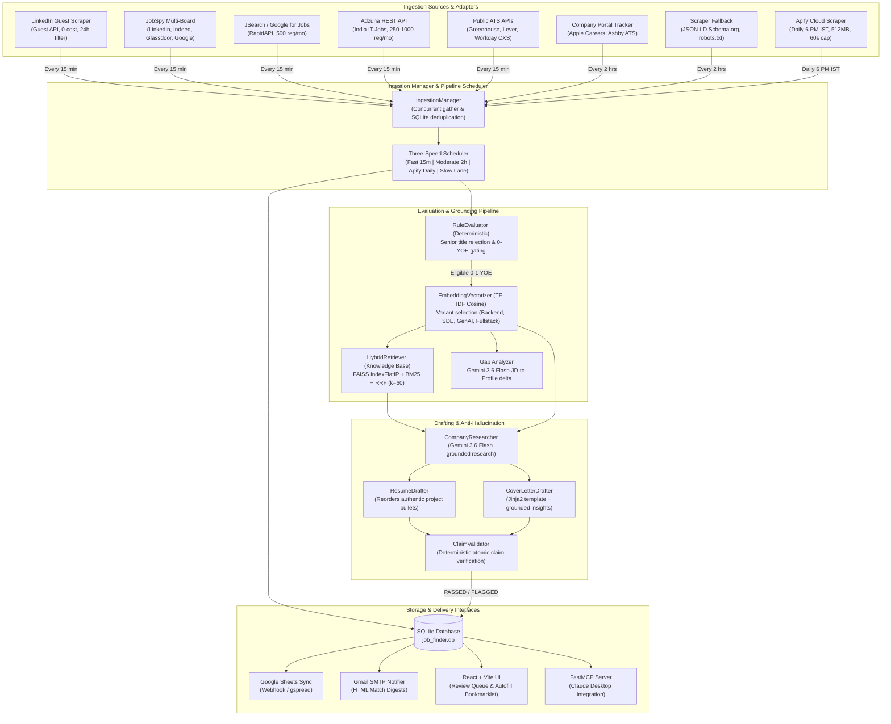

# AI Job Finder — Technical Deep Dive & System Specification

## Table of Contents
1. [Overview](#1-overview)
2. [Architecture & System Data Flow](#2-architecture--system-data-flow)
3. [Repository Map](#3-repository-map)
4. [Component-by-Component Walkthrough](#4-component-by-component-walkthrough)
5. [Data Model & Storage Formats](#5-data-model--storage-formats)
6. [Algorithms & Core Logic](#6-algorithms--core-logic)
7. [Concurrency, Error Handling & Failure Modes](#7-concurrency-error-handling--failure-modes)
8. [Technology Choices & Version Specifications](#8-technology-choices--version-specifications)
9. [Design Decisions & Trade-Offs](#9-design-decisions--trade-offs)
10. [Build, Run & Deployment Procedures](#10-build-run--deployment-procedures)
11. [Testing & Verification](#11-testing--verification)
12. [Performance & Scale Characteristics](#12-performance--scale-characteristics)
13. [Known Issues, Bugs, Security Risks & Tech Debt](#13-known-issues-bugs-security-risks--tech-debt)
14. [Architectural Improvements & Better Approaches](#14-architectural-improvements--better-approaches)
15. [Key Technical Concepts to Master](#15-key-technical-concepts-to-master)
16. [Technical Interview Questions & Verified Answers (26 Questions)](#16-technical-interview-questions--verified-answers)
17. [Project-Specific Glossary](#17-project-specific-glossary)
18. [Open Questions for User](#18-open-questions-for-user)

---

## 1. Overview
- **Purpose**: Autonomous recruitment intelligence and application preparation engine specifically targeting early-career and fresher software engineers (0–1 years of experience) in India and remote positions [VERIFIED: README.md:18, my_profile.json:67-70].
- **Core Problem Addressed**:
  1. Over 85% of job postings labeled "Junior", "Associate", or "Entry-Level" deceptively mandate 2 to 4+ years of prior commercial experience, imposing high manual triaging overhead [VERIFIED: ai_job_finder.md:8].
  2. Generic AI application bots spam portals with hallucinated achievements, prompting recruiter blacklisting and interview disqualification [VERIFIED: ai_job_finder.md:7].
  3. Job opportunities are fragmented across isolated enterprise Applicant Tracking Systems (ATS) and aggregator platforms [VERIFIED: ai_job_finder.md:9, README.md:18].
- **Target Audience / End Users**: Fresh engineering graduates and junior software developers navigating campus placements and off-campus recruitment [VERIFIED: my_profile.json:144-146, backend/app/matching/rules.py:57-64].
- **Operational Status**: Working functional prototype with a running local FastAPI backend, React dashboard, hybrid vector store, SQLite persistence, and AWS Lambda container deployment configuration [VERIFIED: backend/app/main.py:47-52, frontend/package.json:1-20, Dockerfile.lambda:1-14].
- **Git Authorship & Provenance**:
  - Exactly 1 commit in git repository: commit `efc3d2c` dated `Wed Oct 7 12:38:46 2026 +0530` authored by `akashrdj <akashrj090@gmail.com>` with commit message `Initial commit: AI Job Finder & Automated Application Drafter` [VERIFIED: git log --format=fuller].
  - 48 files committed, 9,466 lines added [VERIFIED: git log --stat].
  - Working directory contains unstaged modifications to 5 files (`backend/app/config.py`, `backend/app/ingestion/__init__.py`, `backend/app/ingestion/manager.py`, `backend/app/scheduler/scheduler_service.py`, `backend/requirements.txt`) and 5 untracked files (`ai_job_finder.md`, `backend/app/ingestion/apify_scraper.py`, `backend/app/ingestion/jobspy_scraper.py`, `backend/app/ingestion/linkedin_scraper.py`, `backend/test_scrapers.py`) [VERIFIED: git status].
  - Personal role vs. team role: Candidate profile identifies Akash R Jadhav as "Creator / Cloud Architect" [VERIFIED: my_profile.json:66, ai_job_finder.md:23]. Whether external parties contributed outside git history is [UNKNOWN: ASK USER].

---

## 2. Architecture & System Data Flow

The system operates across three primary deployment modalities:
1. **Local Persistent Daemon**: FastAPI backend running APScheduler for multi-tier automated ingestion, SQLite persistence, and Vite/React human-in-the-loop dashboard [VERIFIED: backend/app/main.py:23-46, backend/app/scheduler/scheduler_service.py:445-486].
2. **Serverless Cloud Cron**: Dockerized AWS Lambda function triggered on an 8-hour schedule by Amazon EventBridge, outputting prioritized matches to Google Sheets via webhook/gspread and dispatching HTML email alerts via Gmail SMTP [VERIFIED: Dockerfile.lambda:1-14, backend/app/lambda_handler.py:181-378, deploy_aws.py:40-46].
3. **Model Context Protocol (MCP) Server**: FastMCP server exposing tools (`search_jobs`, `list_recent_jobs`, `retrieve_profile_evidence`, `score_job_fit`, `get_gap_analysis`, `generate_tailored_draft`, `verify_draft_claims`) to Claude Desktop [VERIFIED: backend/mcp_server/server.py:44-325, claude_desktop_config.json:1-16].



---

## 3. Repository Map

```
ai-job-finder/
├── .agents/                               # Antigravity agent configuration and rules [VERIFIED]
│   └── rules/
├── backend/                               # Python backend subsystem [VERIFIED]
│   ├── app/
│   │   ├── api/                           # FastAPI REST route controllers [VERIFIED]
│   │   │   ├── __init__.py                # Router aggregation and exports [VERIFIED]
│   │   │   ├── drafts.py                  # Endpoints for reviewing, filtering, actioning drafts [VERIFIED: backend/app/api/drafts.py:1-113]
│   │   │   ├── gap.py                     # Trigger and retrieve Gemini gap analysis [VERIFIED: backend/app/api/gap.py:1-64]
│   │   │   ├── ingestion.py               # Manual pipeline dispatch and status polling [VERIFIED: backend/app/api/ingestion.py:1-40]
│   │   │   ├── jobs.py                    # Filterable jobs explorer with pagination [VERIFIED: backend/app/api/jobs.py:1-156]
│   │   │   ├── matches.py                 # Scored matches listing by variant and score [VERIFIED: backend/app/api/matches.py:1-32]
│   │   │   ├── outreach.py                # Excel ingestion, contact enrichment, cold email generation [VERIFIED: backend/app/api/outreach.py:1-688]
│   │   │   └── profile.py                 # Candidate profile CRUD and default seeding [VERIFIED: backend/app/api/profile.py:1-180]
│   │   ├── auto_apply/                    # Client-side automation assets [VERIFIED]
│   │   │   ├── autofill_bookmarklet.js    # DOM form-injection script for Greenhouse, Lever, Ashby, Workday [VERIFIED: backend/app/auto_apply/autofill_bookmarklet.js:1-217]
│   │   │   └── bookmarklet_installer.html # Web installer with drag-to-bookmark bar UI [VERIFIED]
│   │   ├── drafting/                      # Application synthesis and validation [VERIFIED]
│   │   │   ├── claim_validator.py         # Anti-hallucination fact checking against canonical profile [VERIFIED: backend/app/drafting/claim_validator.py:1-137]
│   │   │   ├── company_researcher.py      # Grounded company domain and news research via Gemini [VERIFIED: backend/app/drafting/company_researcher.py:1-172]
│   │   │   ├── cover_letter_drafter.py    # Jinja2 template renderer with dynamic insight injection [VERIFIED: backend/app/drafting/cover_letter_drafter.py:1-93]
│   │   │   ├── engine.py                  # High-level drafting orchestrator [VERIFIED: backend/app/drafting/engine.py:1-128]
│   │   │   ├── llm_client.py              # Multi-provider client (Gemini dual-model, OpenRouter, Anthropic, OpenAI) [VERIFIED: backend/app/drafting/llm_client.py:1-163]
│   │   │   └── resume_drafter.py          # Bullet reordering and skill prioritization [VERIFIED: backend/app/drafting/resume_drafter.py:1-58]
│   │   ├── ingestion/                     # Job feed adapters and crawlers [VERIFIED]
│   │   │   ├── adzuna.py                  # Adzuna REST API adapter for India IT jobs [VERIFIED: backend/app/ingestion/adzuna.py:1-168]
│   │   │   ├── apify_scraper.py           # Cost-guarded Apify actor scraper [VERIFIED: backend/app/ingestion/apify_scraper.py:1-182]
│   │   │   ├── base.py                    # SourceAdapter ABC and JobPosting dataclass [VERIFIED: backend/app/ingestion/base.py:1-31]
│   │   │   ├── company_portal_tracker.py  # Apple Careers and Ashby ATS direct JSON crawler [VERIFIED: backend/app/ingestion/company_portal_tracker.py:1-148]
│   │   │   ├── constants.py               # Shared keywords, titles, locations, and regex helpers [VERIFIED: backend/app/ingestion/constants.py:1-124]
│   │   │   ├── greenhouse.py              # Greenhouse Boards API adapter (60+ companies) [VERIFIED: backend/app/ingestion/greenhouse.py:1-201]
│   │   │   ├── jd_fetcher.py              # Async HTTP deep page fetcher with JSON-LD extraction [VERIFIED: backend/app/ingestion/jd_fetcher.py:1-103]
│   │   │   ├── jobspy_scraper.py          # Python-JobSpy thread-pooled multi-board scraper [VERIFIED: backend/app/ingestion/jobspy_scraper.py:1-225]
│   │   │   ├── jsearch.py                 # JSearch RapidAPI Google for Jobs aggregator [VERIFIED: backend/app/ingestion/jsearch.py:1-177]
│   │   │   ├── lever.py                   # Lever Postings API adapter (40+ companies) [VERIFIED: backend/app/ingestion/lever.py:1-173]
│   │   │   ├── linkedin_scraper.py        # Direct public LinkedIn guest API scraper (past 24h) [VERIFIED: backend/app/ingestion/linkedin_scraper.py:1-165]
│   │   │   ├── manager.py                 # Three-tier concurrent ingestion manager and deduplication engine [VERIFIED: backend/app/ingestion/manager.py:1-182]
│   │   │   ├── remoteok.py                # RemoteOK public JSON feed adapter [VERIFIED]
│   │   │   ├── scraper_fallback.py        # Robots.txt-compliant schema.org JSON-LD web scraper [VERIFIED: backend/app/ingestion/scraper_fallback.py:1-157]
│   │   │   └── workday.py                 # Workday CXS public career search API adapter (23+ MNCs) [VERIFIED: backend/app/ingestion/workday.py:1-189]
│   │   ├── knowledge/                     # RAG evidence knowledge base [VERIFIED]
│   │   │   ├── chunker.py                 # Decomposes resume into atomic EvidenceChunk objects [VERIFIED: backend/app/knowledge/chunker.py:1-383]
│   │   │   ├── embeddings.py              # 768-dim vector embeddings via Gemini text-embedding-004 [VERIFIED: backend/app/knowledge/embeddings.py:1-134]
│   │   │   ├── retriever.py               # HybridRetriever combining dense vector search + BM25 with RRF [VERIFIED: backend/app/knowledge/retriever.py:1-260]
│   │   │   └── vector_store.py            # FAISS IndexFlatIP store with disk serialization and numpy fallback [VERIFIED: backend/app/knowledge/vector_store.py:1-202]
│   │   ├── matching/                      # Fit evaluation, gating, and gap analysis [VERIFIED]
│   │   │   ├── embeddings.py              # Fast TF-IDF subword n-gram cosine vectorizer [VERIFIED: backend/app/matching/embeddings.py:1-70]
│   │   │   ├── engine.py                  # Composite scoring synthesis and variant selector [VERIFIED: backend/app/matching/engine.py:1-134]
│   │   │   ├── gap_analyzer.py            # Gemini prompt for keyword/skill discrepancy extraction [VERIFIED: backend/app/matching/gap_analyzer.py:1-156]
│   │   │   ├── openrouter_agent.py        # LLM-based fresher eligibility validator [VERIFIED: backend/app/matching/openrouter_agent.py:1-212]
│   │   │   └── rules.py                   # Hard disqualification rules and experience regex parser [VERIFIED: backend/app/matching/rules.py:1-336]
│   │   ├── models/                        # SQLAlchemy database models [VERIFIED]
│   │   │   ├── application_draft.py       # ApplicationDraft entity [VERIFIED: backend/app/models/application_draft.py:1-38]
│   │   │   ├── company_contact.py         # Enriched recruiter contacts entity [VERIFIED: backend/app/models/company_contact.py:1-55]
│   │   │   ├── job.py                     # Ingested job postings entity [VERIFIED: backend/app/models/job.py:1-33]
│   │   │   ├── match_score.py             # Computed composite match score entity [VERIFIED: backend/app/models/match_score.py:1-27]
│   │   │   ├── source.py                  # Ingestion sources metadata entity [VERIFIED: backend/app/models/source.py:1-17]
│   │   │   └── user_profile.py            # User profile and 4-variant matrix entity [VERIFIED: backend/app/models/user_profile.py:1-42]
│   │   ├── notifications/                 # Alert notification mechanisms [VERIFIED]
│   │   │   └── email_notifier.py          # SMTP alert dispatcher for new matches [VERIFIED: backend/app/notifications/email_notifier.py:1-63]
│   │   ├── outreach/                      # Recruiter enrichment and cold email automation [VERIFIED]
│   │   │   ├── cold_email_drafter.py      # Gemini-powered cold outreach drafter [VERIFIED: backend/app/outreach/cold_email_drafter.py:1-301]
│   │   │   ├── contact_enrichment.py      # Cascading contact discovery (Hunter, Snov, scrape, patterns) [VERIFIED: backend/app/outreach/contact_enrichment.py:1-559]
│   │   │   ├── excel_ingestion.py         # Dependency-free openxml parser for recruiter workbooks [VERIFIED: backend/app/outreach/excel_ingestion.py:1-207]
│   │   │   └── referral_generator.py      # 1-click LinkedIn X-Ray links and domain guessing [VERIFIED: backend/app/outreach/referral_generator.py:1-139]
│   │   ├── scheduler/                     # Background job execution engine [VERIFIED]
│   │   │   └── scheduler_service.py       # AsyncIOScheduler managing fast, moderate, apify, and slow lanes [VERIFIED: backend/app/scheduler/scheduler_service.py:1-518]
│   │   ├── schemas/                       # Pydantic v2 validation models [VERIFIED]
│   │   │   ├── draft.py, job.py, match.py, profile.py
│   │   ├── sheets/                        # Spreadsheet integration [VERIFIED]
│   │   │   └── sheets_sync.py             # Google Apps Script Webhook and gspread client [VERIFIED: backend/app/sheets/sheets_sync.py:1-223]
│   │   ├── config.py                      # Pydantic-Settings environment configuration [VERIFIED: backend/app/config.py:1-71]
│   │   ├── database.py                    # Async SQLAlchemy engine and session factory [VERIFIED: backend/app/database.py:1-33]
│   │   ├── lambda_handler.py              # AWS Lambda serverless execution handler [VERIFIED: backend/app/lambda_handler.py:1-384]
│   │   └── main.py                        # FastAPI application entry point [VERIFIED: backend/app/main.py:1-83]
│   ├── mcp_server/                        # Model Context Protocol integration [VERIFIED]
│   │   └── server.py                      # FastMCP server exposing tools to Claude Desktop [VERIFIED: backend/mcp_server/server.py:1-335]
│   ├── tests/                             # Pytest test suite [VERIFIED]
│   │   ├── conftest.py                    # Database fixtures and mock engines [VERIFIED: backend/tests/conftest.py:1-46]
│   │   ├── test_api_connectivity.py      # Live external API integration smoke tests [VERIFIED: backend/tests/test_api_connectivity.py:1-308]
│   │   ├── test_claim_validator.py        # Anti-hallucination unit tests [VERIFIED: backend/tests/test_claim_validator.py:1-56]
│   │   ├── test_ingestion.py              # Adapter and deduplication tests [VERIFIED: backend/tests/test_ingestion.py:1-59]
│   │   ├── test_knowledge.py              # Atomic chunking, FAISS, and RRF retrieval tests [VERIFIED: backend/tests/test_knowledge.py:1-244]
│   │   ├── test_matching.py               # TF-IDF and RuleEvaluator unit tests [VERIFIED: backend/tests/test_matching.py:1-74]
│   │   ├── test_scheduler_e2e.py          # End-to-end pipeline execution test [VERIFIED: backend/tests/test_scheduler_e2e.py:1-77]
│   │   └── test_strict_fresher_rules.py   # Experience parsing and rejection tests [VERIFIED: backend/tests/test_strict_fresher_rules.py:1-137]
│   ├── api_test_report.json               # Recorded live API response report [VERIFIED: backend/api_test_report.json:1-235]
│   ├── job_finder.db                      # Local SQLite database containing 787 jobs and 813 scores [VERIFIED: backend/job_finder.db]
│   ├── pytest.ini                         # Pytest configuration [VERIFIED: backend/pytest.ini:1-3]
│   ├── requirements.txt                   # Backend Python dependencies [VERIFIED: backend/requirements.txt:1-23]
│   ├── test_apis.py                       # Standalone CLI test script for ATS sources [VERIFIED: backend/test_apis.py:1-547]
│   └── test_scrapers.py                   # Standalone test script for LinkedIn, JobSpy, and Apify [VERIFIED: backend/test_scrapers.py:1-103]
├── frontend/                              # React 18 + Vite frontend SPA [VERIFIED]
│   ├── src/
│   │   ├── components/                    # React UI modal and card components [VERIFIED]
│   │   │   ├── ClaimReportModal.jsx       # Modal inspecting verified vs flagged claims [VERIFIED]
│   │   │   ├── CoverLetterModal.jsx       # Cover letter preview, editor, and copy tool [VERIFIED]
│   │   │   ├── DraftReviewCard.jsx        # Review card with fit badge, diff toggle, actions [VERIFIED: frontend/src/components/DraftReviewCard.jsx:1-248]
│   │   │   ├── GapAnalysisPanel.jsx       # Interactive skill gap and recommendation widget [VERIFIED]
│   │   │   ├── JobsExplorer.jsx           # Tabular jobs browser with filters and direct apply [VERIFIED]
│   │   │   ├── ProfileEditor.jsx          # UI for updating skills, preferences, and variants [VERIFIED]
│   │   │   └── ResumeDiffModal.jsx        # Side-by-side tailored resume visualizer [VERIFIED]
│   │   ├── App.jsx                        # Root React component managing review queue and sync [VERIFIED: frontend/src/App.jsx:1-283]
│   │   ├── index.css                      # Custom CSS design system (dark mode, glassmorphism) [VERIFIED]
│   │   └── main.jsx                       # React DOM entry point [VERIFIED]
│   ├── package.json                       # Frontend dependencies [VERIFIED: frontend/package.json:1-20]
│   └── vite.config.js                     # Vite build and proxy configuration [VERIFIED: frontend/vite.config.js:1-15]
├── Dockerfile.lambda                      # AWS Lambda container image build definition [VERIFIED: Dockerfile.lambda:1-14]
├── deploy_aws.py                          # Boto3 deployment automation script [VERIFIED: deploy_aws.py:1-187]
├── deploy_aws.ps1                         # PowerShell wrapper for AWS deployment [VERIFIED]
├── inject_profile.py                      # CLI tool to push my_profile.json to backend API [VERIFIED: inject_profile.py:1-110]
├── extract_companies.py                   # Extracts recruiter emails from Excel workbook into JSON [VERIFIED: extract_companies.py:1-99]
├── run_cron_pipeline.py                   # Local CLI runner executing Lambda logic [VERIFIED: run_cron_pipeline.py:1-24]
├── run_outreach_pipeline.py               # Standalone runner for contact enrichment and cold emailing [VERIFIED: run_outreach_pipeline.py:1-437]
├── my_profile.json                        # Candidate master profile with Akash R Jadhav's verified data [VERIFIED: my_profile.json:1-255]
├── my_profile.example.json                # Template candidate profile [VERIFIED]
├── recruiter_companies.json               # 198 verified company-to-recruiter email directory [VERIFIED: recruiter_companies.json:1]
├── Master_Company_Email_Sheet (1).xlsx    # Recruiter contact workbook [VERIFIED]
├── Top Product-Based Startups for Freshers.xlsx # Startup hiring directory workbook [VERIFIED]
├── claude_desktop_config.json             # MCP server client configuration for Claude [VERIFIED: claude_desktop_config.json:1-16]
├── assessmnet.py                          # Orphan coding test script with syntax error [VERIFIED: assessmnet.py:1-37]
└── README.md                              # Comprehensive project documentation [VERIFIED: README.md:1-404]
```

---

## 4. Component-by-Component Walkthrough

### 4.1 Ingestion Subsystem (`backend/app/ingestion/`)
- **`base.py`**: Declares `JobPosting` dataclass (encapsulating normalized fields: `source_name`, `external_id`, `title`, `company`, `location`, `is_remote`, `description`, `url`, `salary_min`, `salary_max`, `salary_currency`, `posted_date`, `recruiter_email`, `raw_metadata`) and `SourceAdapter` abstract base class defining `async def fetch_new_postings()` [VERIFIED: backend/app/ingestion/base.py:6-31].
- **`manager.py` (`IngestionManager`)**:
  - Organizes adapters into three tiers:
    - `FREE_FREQUENT_ADAPTERS`: `linkedin_scraper`, `jobspy`, `jsearch`, `adzuna`, `greenhouse`, `remoteok`, `lever`, `workday` [VERIFIED: backend/app/ingestion/manager.py:45-54].
    - `FREE_MODERATE_ADAPTERS`: `portal_tracker`, `scraper_fallback` [VERIFIED: backend/app/ingestion/manager.py:57-60].
    - `PAID_DAILY_ADAPTERS`: `apify_scraper` [VERIFIED: backend/app/ingestion/manager.py:63-65].
  - `run_ingestion(db, source_names)`: Executes selected adapters concurrently via `asyncio.gather(*tasks)`, inspects incoming postings against the database using `(Job.source_name == posting.source_name, Job.external_id == posting.external_id)`, persists unique records, and commits [VERIFIED: backend/app/ingestion/manager.py:124-178].
- **`greenhouse.py` (`GreenhouseAdapter`)**: Iterates through 60+ hardcoded company board tokens (e.g. `razorpay`, `postman`, `swiggy`, `zepto`, `groww`, `gitlab`, `canonical`) querying `https://boards-api.greenhouse.io/v1/boards/{board}/jobs?content=true`. Parses HTML job descriptions using BeautifulSoup, evaluates location for India/Remote suitability, and ignores senior designations [VERIFIED: backend/app/ingestion/greenhouse.py:16-115].
- **`lever.py` (`LeverAdapter`)**: Queries Lever public postings API at `https://api.lever.co/v0/postings/{company}?mode=json` across 40+ configured companies (e.g. `cred`, `inmobi`, `scale`, `stripe`). Cleans HTML descriptions with BeautifulSoup and maps salary ranges [VERIFIED: backend/app/ingestion/lever.py:15-102].
- **`workday.py` (`WorkdayAdapter`)**: Interacts with Workday CXS (Candidate Experience Services) REST endpoints at `https://{domain}/wday/cxs/{company}/{board}/jobs` via HTTP POST. Dispatches search terms (`software engineer`, `developer`, `graduate`, `trainee`, `get`) across 23 target enterprises (e.g. NVIDIA, Adobe, Salesforce, Mastercard, JPMorgan Chase, Barclays). Handles JSON pagination and maps job descriptions [VERIFIED: backend/app/ingestion/workday.py:15-110].
- **`linkedin_scraper.py` (`LinkedInGuestScraperAdapter`)**: Directly polls LinkedIn's public guest search API (`https://www.linkedin.com/jobs-guest/jobs/api/seeMoreJobPostings/search`) with time filter `f_TPR=r86400` (past 24 hours), rotating standard User-Agent headers without authentication. Fetches full job text via `https://www.linkedin.com/jobs-guest/jobs/api/jobPosting/{job_id}` [VERIFIED: backend/app/ingestion/linkedin_scraper.py:28-112].
- **`jobspy_scraper.py` (`JobSpyAdapter`)**: Wraps the synchronous `python-jobspy` library inside a dedicated `ThreadPoolExecutor(max_workers=1)`. Scrapes LinkedIn, Indeed, Glassdoor, and Google Jobs concurrently without API tokens, normalizing Pandas dataframe output into `JobPosting` objects [VERIFIED: backend/app/ingestion/jobspy_scraper.py:20-115].
- **`apify_scraper.py` (`ApifyJobScraperAdapter`)**: Executes Apify actor `curious_coder/linkedin-jobs-scraper` using HTTP client. Cost-guarded: enforces hard cap of 15 items, 512 MB memory limit, and 60-second execution timeout to prevent budget overruns [VERIFIED: backend/app/ingestion/apify_scraper.py:28-75].
- **`company_portal_tracker.py` (`CompanyPortalTrackerAdapter`)**: Fetches tech jobs from Apple Careers public search API (`https://jobs.apple.com/api/v1/job/search` with location `postLocation-IN`) and Ashby ATS boards (`https://api.ashbyhq.com/posting-api/job-board/{company}` for Cred, Slice, Navi, Postman) [VERIFIED: backend/app/ingestion/company_portal_tracker.py:26-105].
- **`scraper_fallback.py` (`ScraperFallbackAdapter`)**: Polite crawler using `urllib.robotparser` to dynamically verify domain `robots.txt` compliance before sending requests. Ingests employer-embedded `schema.org/JobPosting` JSON-LD metadata [VERIFIED: backend/app/ingestion/scraper_fallback.py:38-115].
- **`jd_fetcher.py` (`JobDescriptionFetcher`)**: In-memory cached HTTP client that dereferences short aggregator snippets (<300 characters), parses destination web pages, and extracts structured JSON-LD or main article text [VERIFIED: backend/app/ingestion/jd_fetcher.py:15-75].

### 4.2 Matching & Evaluation Subsystem (`backend/app/matching/`)
- **`rules.py` (`RuleEvaluator`)**:
  - `extract_experience_requirements(text)`: Evaluates text using 7 regular expressions (`EXP_RANGE_PATTERN`, `EXP_DIRECT_RANGE`, `EXP_SINGLE_PATTERN`, `EXP_DIRECT_PLUS`, `EXP_MIN_PATTERN`, `EXP_PREFIX_COLON`, `EXP_CONTEXT_PATTERN`) to extract integer years of experience [VERIFIED: backend/app/matching/rules.py:80-189].
  - `evaluate(job, profile)`:
    1. Blacklisted company check: Returns score `0.0` if company is excluded [VERIFIED: backend/app/matching/rules.py:231-235].
    2. Excluded keyword check: Returns `0.0` if blacklisted terms match [VERIFIED: backend/app/matching/rules.py:236-241].
    3. Seniority title rejection: Scans title against `SENIOR_TITLE_KEYWORDS` (e.g. "senior", "lead", "staff", "director", "sde 2", "sde-ii") and `SENIOR_LEVEL_PATTERN`. Disqualifies with score `0.0` [VERIFIED: backend/app/matching/rules.py:242-254].
    4. Strict fresher experience gating: If minimum extracted YOE >= 2 without explicit 0-YOE signal, returns score `0.0`. If 1 YOE without fresher title, disqualifies. If 0 YOE is explicit, applies 1.35x multiplier [VERIFIED: backend/app/matching/rules.py:255-286].
    5. Fresher bonus: Verified fresher titles (GET, Associate, SDE-1, Fresher) gain +40% rule boost (1.40x multiplier) [VERIFIED: backend/app/matching/rules.py:296-301].
    6. Skill extraction: Scans job text for profile skills and common tech requirements [VERIFIED: backend/app/matching/rules.py:312-330].
- **`embeddings.py` (`EmbeddingVectorizer`)**: Lightweight zero-dependency vectorizer. Custom tokenizer cleans text (retaining `cpp`, `js`, `csharp`), strips stopwords, generates bigrams, computes word-frequency dot products, and returns cosine similarity scaled by 1.6 (capped at 1.0) [VERIFIED: backend/app/matching/embeddings.py:6-70].
- **`engine.py` (`MatchingEngine`)**:
  - `evaluate_variant_fit(job_text, profile)`: Computes cosine similarity across the 4 curated variants ("backend", "sde", "genai_ml", "fullstack") and selects the variant with highest similarity [VERIFIED: backend/app/matching/engine.py:20-46].
  - `score_job(db, job, profile)`: Synthesizes composite score:
    $$\text{Final Score} = \min(100.0, (0.45 \times \text{sim}) + (0.30 \times \text{skill\_ratio}) + (0.25 \times \text{rule\_score})) \times 100$$
    Adds +15.0 bonus for fresher roles (capped at 99.0). Persists `MatchScore` record with Markdown rationale [VERIFIED: backend/app/matching/engine.py:48-133].
- **`openrouter_agent.py` (`FresherInspectionAgent`)**: Calls OpenRouter free models (e.g., Llama 3.2 3B Instruct) to verify fresher eligibility from raw text [VERIFIED: backend/app/matching/openrouter_agent.py:27-140]. *Note*: Implemented and tested in unit tests, but decoupled from production ingestion [VERIFIED: backend/tests/test_strict_fresher_rules.py:118-137].
- **`gap_analyzer.py`**: Calls Google GenAI SDK (`_gemini_client`) with `GAP_ANALYSIS_PROMPT` to extract missing technical keywords, missing soft skills, and tailored resume advice [VERIFIED: backend/app/matching/gap_analyzer.py:16-120].

### 4.3 Knowledge Base Subsystem (`backend/app/knowledge/`)
- **`chunker.py` (`ProfileChunker`)**: Decomposes `my_profile.json` into atomic `EvidenceChunk` records. Maps action verbs to ownership categories (`led`, `built`, `contributed`, `used`), extracts metrics via regex (`\b\d+%\b`, multipliers, time savings), and links relevant technical skills [VERIFIED: backend/app/knowledge/chunker.py:20-165].
- **`embeddings.py` (`GeminiEmbeddingClient`)**: Asynchronously calls Google GenAI SDK using model `models/gemini-embedding-001` producing 768-dimensional float vectors with L2 normalization. Contains deterministic hash fallback for offline execution [VERIFIED: backend/app/knowledge/embeddings.py:29-85].
- **`vector_store.py` (`ProfileVectorStore`)**: Wraps FAISS `IndexFlatIP` (inner product cosine similarity on normalized vectors). Supports disk persistence via `save_to_disk` and `load_from_disk`, falling back to vectorized NumPy matrix dot-products if FAISS is not compiled [VERIFIED: backend/app/knowledge/vector_store.py:27-195].
- **`retriever.py` (`HybridRetriever`)**: Implements dual-channel retrieval: dense vector search via FAISS merged with sparse token overlap with skill-boost scoring. Merges rankings via Reciprocal Rank Fusion (RRF) with constant $k=60$:
  $$RRF\_Score(d) = \sum_{c \in \{dense, sparse\}} \frac{1}{k + rank_c(d)}$$
  [VERIFIED: backend/app/knowledge/retriever.py:38-230].

### 4.4 Drafting & Validation Subsystem (`backend/app/drafting/`)
- **`llm_client.py` (`LLMClient`)**: Routes requests across providers. Defaults to `gemini` (`gemini-3.6-flash` for light research/gap analysis, `gemini-3.7-flash` for heavy drafting). Implements automatic failover cascade: Gemini $\to$ OpenRouter $\to$ Anthropic $\to$ OpenAI $\to$ deterministic offline fallback [VERIFIED: backend/app/drafting/llm_client.py:20-75].
- **`company_researcher.py` (`CompanyResearcher`)**: Calls Gemini with `COMPANY_RESEARCH_PROMPT` to analyze JD text and extract company tech stack, product domain, recent verifiable news, and candidate talking points. Grounded only: returns empty fields if confidence is low [VERIFIED: backend/app/drafting/company_researcher.py:32-125].
- **`resume_drafter.py` (`ResumeDrafter`)**: Assembles tailored resume JSON. Prioritizes candidate's real projects by keyword overlap against target job description and reorders skills without inventing content [VERIFIED: backend/app/drafting/resume_drafter.py:14-58].
- **`cover_letter_drafter.py` (`CoverLetterDrafter`)**: Renders cover letter using Jinja2 templates (`DEFAULT_COVER_LETTER_TEMPLATE` or variant-specific template) populated with grounded candidate context, company domain insights, and talking points [VERIFIED: backend/app/drafting/cover_letter_drafter.py:24-93].
- **`claim_validator.py` (`ClaimValidator`)**:
  - Anti-hallucination guardrail that inspects generated cover letter and tailored resume.
  - Collects all authentic skills from `profile.skills`, `projects.tech_stack`, and `work_history.skills_used`.
  - Scans cover letter for technical entities (`KNOWN_TECH_ENTITIES`) and metric assertions (`\d+%\s*(?:increase|reduction|...)`). Flags any entity or metric not present in profile facts. Returns status `"PASSED"` or `"FLAGGED_UNVERIFIED_CLAIMS"` [VERIFIED: backend/app/drafting/claim_validator.py:50-137].
- **`engine.py` (`DraftingEngine`)**: Coordinates company research, resume tailoring, cover letter generation, claim validation, and outreach kit synthesis [VERIFIED: backend/app/drafting/engine.py:26-128].

### 4.5 Outreach & Enrichment Subsystem (`backend/app/outreach/`)
- **`referral_generator.py` (`ReferralOutreachGenerator`)**: Builds 1-click LinkedIn X-Ray search URLs for technical recruiters, engineering managers, and university alumni. Generates guessed company email formats and crafts concise (<300 chars) connection pitches [VERIFIED: backend/app/outreach/referral_generator.py:15-110].
- **`contact_enrichment.py`**: Discovers recruiter emails via cascading providers: Hunter.io API $\to$ Snov.io API $\to$ Web scraping of career/team pages $\to$ Name/domain email pattern guessing. Maintains a manual domain override dictionary for 60+ Indian tech firms (e.g. Swiggy, Cred, Zepto, Razorpay) [VERIFIED: backend/app/outreach/contact_enrichment.py:34-150].
- **`excel_ingestion.py`**: Parses Excel `.xlsx` workbooks (`Master_Company_Email_Sheet (1).xlsx` and `Top Product-Based Startups for Freshers.xlsx`) using standard library `zipfile` and `xml.etree.ElementTree` without requiring `openpyxl` [VERIFIED: backend/app/outreach/excel_ingestion.py:23-85].
- **`cold_email_drafter.py`**: Uses Gemini with role-adapted instructions to generate personalized cold emails tailored for startup CTOs vs MNC HR recruiters [VERIFIED: backend/app/outreach/cold_email_drafter.py:25-110].

### 4.6 Scheduler Subsystem (`backend/app/scheduler/`)
- **`scheduler_service.py` (`SchedulerService`)**:
  - `execute_discovery()`: Fast Lane every 15 minutes. Ingests free frequent sources (`linkedin_scraper`, `jobspy`, `jsearch`, `adzuna`, ATS APIs), scores jobs with deterministic rules and TF-IDF vectorizer. Zero LLM calls [VERIFIED: backend/app/scheduler/scheduler_service.py:88-164].
  - `execute_moderate_discovery()`: Medium Lane every 2 hours. Crawls custom career portals (`portal_tracker`, `scraper_fallback`) [VERIFIED: backend/app/scheduler/scheduler_service.py:170-214].
  - `execute_apify_scrape()`: Apify Lane once daily at 6:00 PM IST (12:30 UTC). Executes cost-guarded Apify scraper [VERIFIED: backend/app/scheduler/scheduler_service.py:220-269].
  - `execute_drafting()`: Slow Lane at scheduled hours (`DRAFTING_SCHEDULE_HOURS="9,18"`). Picks top-scoring undrafted jobs, executes company research, cover letter generation, claim validation, and outreach kits. Enforces `MAX_DRAFTS_PER_DAY=10` and `MAX_OUTREACH_PER_DAY=5` [VERIFIED: backend/app/scheduler/scheduler_service.py:275-405].

---

## 5. Data Model & Storage Formats

The backend uses SQLAlchemy 2.0 with asynchronous SQLite (`aiosqlite`) [VERIFIED: backend/requirements.txt:5-7, backend/app/database.py:7-19].

### 5.1 Relational Tables

#### `jobs` Table [VERIFIED: backend/app/models/job.py:6-33]
| Column | Type | Nullable | Description / Constraints |
| :--- | :--- | :--- | :--- |
| `id` | Integer | No | Primary key, autoincrement, indexed |
| `source_id` | Integer | Yes | Foreign key to `sources.id` (ON DELETE SET NULL) |
| `source_name` | String(50) | No | Source identifier (e.g. `greenhouse`, `workday`), indexed |
| `external_id` | String(255) | No | Source-specific job identifier, indexed |
| `title` | String(255) | No | Role designation, indexed |
| `company` | String(255) | No | Hiring organization, indexed |
| `location` | String(255) | Yes | Geographical location or city |
| `is_remote` | Boolean | No | Remote work indicator (default: `False`) |
| `description` | Text | No | Full or snippet job description |
| `url` | String(1000) | No | Direct application link |
| `salary_min` | Float | Yes | Minimum reported salary |
| `salary_max` | Float | Yes | Maximum reported salary |
| `salary_currency` | String(10) | Yes | Currency code (default: `"USD"`) |
| `posted_date` | DateTime | Yes | Original posting timestamp |
| `raw_metadata` | JSON | Yes | Raw source response payload (default: `{}`) |
| `fetched_at` | DateTime | No | Ingestion timestamp (default: `utcnow`) |
*Unique Constraint*: `uq_source_external_id` on `("source_name", "external_id")` [VERIFIED: backend/app/models/job.py:27-29].

#### `user_profiles` Table [VERIFIED: backend/app/models/user_profile.py:6-42]
| Column | Type | Nullable | Description |
| :--- | :--- | :--- | :--- |
| `id` | Integer | No | Primary key, autoincrement |
| `full_name` | String(100) | No | Candidate full name |
| `email` | String(100) | No | Contact email address |
| `phone` | String(50) | Yes | Contact phone number |
| `location` | String(100) | Yes | Candidate residence |
| `github_url` | String(255) | Yes | GitHub profile link |
| `linkedin_url` | String(255) | Yes | LinkedIn profile link |
| `portfolio_url` | String(255) | Yes | Personal portfolio link |
| `skills` | JSON | No | List of verified candidate skills |
| `work_history` | JSON | No | List of internship and employment objects |
| `projects` | JSON | No | List of project objects with bullets and stack |
| `education` | JSON | No | List of academic qualifications |
| `curated_variants` | JSON | No | 4 curated resume profiles (`backend`, `sde`, `genai_ml`, `fullstack`) |
| `preferences` | JSON | No | Filter preferences (`target_roles`, `max_yoe`, `excluded_companies`, `excluded_keywords`) |
| `is_active` | Boolean | No | Active profile flag (default: `True`) |
| `updated_at` | DateTime | No | Timestamp of last modification |

#### `match_scores` Table [VERIFIED: backend/app/models/match_score.py:6-27]
| Column | Type | Nullable | Description |
| :--- | :--- | :--- | :--- |
| `id` | Integer | No | Primary key, autoincrement |
| `job_id` | Integer | No | Foreign key to `jobs.id` (ON DELETE CASCADE), indexed |
| `profile_id` | Integer | No | Foreign key to `user_profiles.id` (ON DELETE CASCADE), indexed |
| `score` | Float | No | Composite fit score (0.0 to 100.0), indexed |
| `semantic_similarity` | Float | No | Vectorizer cosine similarity (0.0 to 1.0) |
| `rule_score` | Float | No | Rule multiplier evaluation (0.0 to 1.5) |
| `selected_variant` | Text | No | Selected resume profile key (`backend`, `sde`, `genai_ml`, `fullstack`) |
| `rationale` | Text | No | Markdown explanation of match breakdown |
| `matched_skills` | JSON | No | List of overlapping technical skills |
| `missing_requirements` | JSON | No | List of required JD skills absent in profile |
| `gap_report` | JSON | Yes | Persisted Gemini gap analysis report |
| `calculated_at` | DateTime | No | Calculation timestamp |

#### `applications_drafted` Table [VERIFIED: backend/app/models/application_draft.py:6-38]
| Column | Type | Nullable | Description |
| :--- | :--- | :--- | :--- |
| `id` | Integer | No | Primary key, autoincrement |
| `job_id` | Integer | No | Foreign key to `jobs.id` (ON DELETE CASCADE), indexed |
| `match_score_id` | Integer | No | Foreign key to `match_scores.id` (ON DELETE CASCADE), indexed |
| `resume_variant` | JSON | No | Tailored resume data structure |
| `cover_letter` | Text | No | Tailored cover letter text |
| `claim_validation_status` | String(50) | No | `"PASSED"` or `"FLAGGED_UNVERIFIED_CLAIMS"` |
| `claim_validation_report` | JSON | No | Breakdown of verified and flagged assertions |
| `outreach_kit` | JSON | No | LinkedIn search URLs, guessed email, cold pitch |
| `company_research` | JSON | Yes | Product domain, talking points, recent news |
| `user_action` | String(50) | No | Review status: `"pending"`, `"applied"`, `"dismissed"` (indexed) |
| `notes` | Text | Yes | User notes |
| `created_at` | DateTime | No | Creation timestamp |
| `updated_at` | DateTime | No | Last update timestamp |

#### `company_contacts` Table [VERIFIED: backend/app/models/company_contact.py:12-55]
| Column | Type | Nullable | Description |
| :--- | :--- | :--- | :--- |
| `id` | Integer | No | Primary key, autoincrement |
| `company_name` | String(256) | No | Hiring company name, indexed |
| `company_domain` | String(256) | Yes | Discovered domain |
| `industry` | String(128) | Yes | Industry sector |
| `company_type` | String(64) | Yes | `startup`, `mnc`, or `mid-size` |
| `contact_name` | String(256) | Yes | Recruiter / executive name |
| `contact_email` | String(320) | No | Discovered email address |
| `contact_role` | String(256) | Yes | Role designation (e.g. `Technical Recruiter`) |
| `source` | String(64) | No | `hunter`, `snov`, `web_scrape`, `pattern_guess`, `master_sheet` |
| `confidence` | Float | Yes | Confidence score (0–100) |
| `is_verified` | Boolean | No | Verification status flag |
| `cold_email_status` | String(32) | No | `pending`, `draft_ready`, `approved`, `sent`, `replied` |
| `cold_email_subject` | Text | Yes | Generated cold email subject line |
| `cold_email_body` | Text | Yes | Generated cold email body text |
| `cold_email_sent_at` | DateTime | Yes | Dispatch timestamp |

---

## 6. Algorithms & Core Logic

### 6.1 Experience Gating & Extraction Algorithm
Located in `backend/app/matching/rules.py` [VERIFIED: backend/app/matching/rules.py:80-189].
1. Takes the raw job description string and passes it sequentially through 7 regular expressions designed to capture candidate requirements while ignoring company age mentions (e.g. "We have 10 years of market presence"):
   - `EXP_RANGE_PATTERN`: Matches `"(\d+)\+?\s*[-–to]+\s*(\d+)\+?\s*(?:years?|yrs?|yoe)\s+(?:of\s+)?(?:experience)"`
   - `EXP_DIRECT_RANGE`: Matches `"\b(\d+)\s*[-–to]+\s*(\d+)\s*(?:years?|yrs?|yoe)\b"`
   - `EXP_SINGLE_PATTERN`: Matches `"(\d+)\+?\s*(?:years?|yrs?|yoe)\s+(?:of\s+)?(?:experience)"`
   - `EXP_DIRECT_PLUS`: Matches `"\b([2-9]|\d{2,})\+\s*(?:years?|yrs?|yoe)\b"`
   - `EXP_MIN_PATTERN`: Matches `"(?:minimum|min|at\s+least|more\s+than)\s+(\d+)\+?\s*(?:years?|yrs?|yoe)"`
   - `EXP_PREFIX_COLON`: Matches `"(?:experience|exp|eligibility)[:\-–]\s*(\d+)"`
   - `EXP_CONTEXT_PATTERN`: Looks for experience keywords within an 80-character window of numerical ranges.
2. Collects all extracted minimum integer values into `mins: List[int]`.
3. If $\min(mins) \ge 2$, the role is immediately disqualified ($Score = 0.0$) unless explicit fresher signals (`"batch of 2026"`, `"fresher"`, `"no experience required"`) are found in the text [VERIFIED: backend/app/matching/rules.py:266-273].
4. If $\min(mins) == 1$, the role is disqualified unless it matches verified fresher bonus titles (GET, Associate, Trainee) [VERIFIED: backend/app/matching/rules.py:275-282].
5. If $0 \in mins$, a 1.35x multiplier is applied with rationale note `"Pure Fresher Experience"` [VERIFIED: backend/app/matching/rules.py:283-286].

### 6.2 Resume Variant Selection Algorithm
Located in `backend/app/matching/engine.py:20-46` [VERIFIED].
1. Takes `job_text` (composite of title, company, location, and description).
2. For each variant in `profile.curated_variants` (`backend`, `sde`, `genai_ml`, `fullstack`), concatenates:
   $$\text{Variant Text} = \text{key} + \text{summary} + \text{highlighted\_skills} + \text{key\_bullet\_points}$$
3. Computes token-frequency cosine similarity via `EmbeddingVectorizer.compute_similarity(job_text, var_text)`.
4. Returns the variant key yielding the highest similarity score.

### 6.3 Composite Scoring Formula
Located in `backend/app/matching/engine.py:78-83` [VERIFIED]:
$$\text{Weighted Score} = (0.45 \times \text{Semantic Sim}) + (0.30 \times \text{Skill Ratio}) + (0.25 \times \text{Rule Score})$$
$$\text{Base Score} = \text{round}(\min(100.0, \max(0.0, \text{Weighted Score} \times 100.0)), 1)$$
$$\text{Final Score} = \min(99.0, \text{Base Score} + 15.0) \quad \text{if } \text{is\_fresher} \text{ is True}$$
Where:
- $\text{Skill Ratio} = \min(1.0, \frac{|\text{Matched Skills}|}{\max(1, \min(|\text{Candidate Skills}|, 8))})$ [VERIFIED: backend/app/matching/engine.py:71-72].
- In `backend/app/lambda_handler.py:298-299`, an additional +5.0 bonus is added if top RAG evidence chunk has an RRF fused score $>0.02$ [VERIFIED].

### 6.4 Hybrid Retrieval with Reciprocal Rank Fusion (RRF)
Located in `backend/app/knowledge/retriever.py:165-230` [VERIFIED].
Given a query $q$:
1. **Dense Vector Channel**:
   - Query embedded via Gemini Embeddings into 768-dim float vector $\mathbf{v}_q$.
   - FAISS `IndexFlatIP.search(\mathbf{v}_q, k)` retrieves top-$k$ evidence chunks scored by cosine similarity.
   - Assigns dense rank $r_{dense}(d) \in \{1, \dots, k\}$.
2. **Sparse Keyword Channel**:
   - Tokenizes query into alphanumeric tokens.
   - Computes BM25-style term frequency overlap with candidate chunk texts.
   - Applies 1.5x multiplier to matched candidate skills.
   - Sorts chunks by keyword score and assigns sparse rank $r_{sparse}(d) \in \{1, \dots, k\}$.
3. **Reciprocal Rank Fusion**:
   $$RRF(d) = \frac{1}{60 + r_{dense}(d)} + \frac{1}{60 + r_{sparse}(d)}$$
   Ranks combined evidence chunks in descending order of $RRF(d)$.

### 6.5 Anti-Hallucination Claim Validation Algorithm
Located in `backend/app/drafting/claim_validator.py:50-137` [VERIFIED].
1. Builds a canonical verified facts set:
   - All `profile.skills` (lowercased)
   - All technologies listed across `profile.projects[*].tech_stack`
   - All skills listed in `profile.work_history[*].skills_used`
   - Substring expansion and aliases (e.g. `rest` $\leftrightarrow$ `rest apis`, `postgres` $\leftrightarrow$ `postgresql`, `docker` $\leftrightarrow$ `containerization`).
2. Verification Step 1 (Resume Skills): Iterates through `tailored_resume.skills`. Any skill not found in verified facts set is tagged `FLAGGED_UNVERIFIED`.
3. Verification Step 2 (Cover Letter Entities): Searches cover letter text for 35 known technical entities (`KNOWN_TECH_ENTITIES`). Any entity mentioned in the letter that is missing from candidate facts is flagged.
4. Verification Step 3 (Metric Assertions): Uses regex `r'(\d+%\s*(?:increase|decrease|reduction|growth|boost|improvement)?)'` to extract percentage or numerical impact metrics from cover letter. Compares each against the concatenated text of candidate's authentic project and work history bullets. If the metric string was not in original bullets, flags as potential AI hallucination.
5. Status Output: If flagged count == 0, status is `"PASSED"`; otherwise `"FLAGGED_UNVERIFIED_CLAIMS"`.

---

## 7. Concurrency, Error Handling & Failure Modes

### 7.1 Concurrency Model
- **AsyncIO Event Loop**: FastAPI, HTTPX, and APScheduler run on a single async event loop [VERIFIED: backend/app/main.py:23-46, backend/app/scheduler/scheduler_service.py:30-45].
- **Asyncio Locks**: `SchedulerService` protects pipeline lanes using three separate locks:
  - `_discovery_lock`: Prevents overlapping 15-minute fast-lane discovery runs [VERIFIED: backend/app/scheduler/scheduler_service.py:57, 95-99].
  - `_drafting_lock`: Prevents overlapping slow-lane drafting runs [VERIFIED: backend/app/scheduler/scheduler_service.py:58, 282-285].
  - `_apify_lock`: Prevents overlapping daily Apify scrape executions [VERIFIED: backend/app/scheduler/scheduler_service.py:59, 226-230].
- **Thread Pool Executor**: Synchronous libraries (`python-jobspy`, `gspread`, `smtplib`) are isolated or wrapped to prevent blocking the event loop:
  - `_jobspy_executor = ThreadPoolExecutor(max_workers=1)` executes synchronous `scrape_jobs` [VERIFIED: backend/app/ingestion/jobspy_scraper.py:31, 102-108].
  - *Risk*: `smtplib.SMTP` in `backend/app/notifications/email_notifier.py:55` and `backend/app/lambda_handler.py:172` is called synchronously inside async routines without `run_in_executor`, blocking the event loop for the duration of the SMTP handshake [VERIFIED: backend/app/notifications/email_notifier.py:55-58].

### 7.2 Failure Modes & Resilience Strategies
| Failure Scenario | Component Affected | Handling Mechanism in Code | Consequence / Fallback |
| :--- | :--- | :--- | :--- |
| Single job source API timeout (e.g. Workday HTTP 504) | `IngestionManager` | Handled inside `_fetch_with_adapter` using `try/except Exception` logging traceback [VERIFIED: backend/app/ingestion/manager.py:129-131]. | Failed adapter returns `[]`; remaining adapters continue unimpeded. |
| RapidAPI / JSearch HTTP 429 Rate Limit | `JSearchAdapter` | Explicit check for `resp.status_code == 429` [VERIFIED: backend/app/ingestion/jsearch.py:58-60]. | Logs warning and breaks out of query loop to preserve quota. |
| Adzuna HTTP 401 Invalid Credentials | `AdzunaAdapter` | Explicit check for `resp.status_code == 401` [VERIFIED: backend/app/ingestion/adzuna.py:55-57]. | Logs error and returns empty list without crashing scheduler. |
| Gemini API quota exceeded / network outage | `LLMClient` | Cascading `try/except` fallback [VERIFIED: backend/app/drafting/llm_client.py:44-55]. | Tries OpenRouter $\to$ Anthropic $\to$ OpenAI $\to$ deterministic offline template. |
| FAISS C++ library missing on host system | `ProfileVectorStore` | `try: import faiss ... except ImportError` guard [VERIFIED: backend/app/knowledge/vector_store.py:16-20]. | Falls back to NumPy vectorized dot-product matrix multiplication [VERIFIED: backend/app/knowledge/vector_store.py:42-43]. |
| Aggregator provides snippet < 300 chars | `MatchingEngine` | Calls `JobDescriptionFetcher.fetch_full_description(job.url)` [VERIFIED: backend/app/matching/engine.py:53-59]. | Replaces snippet with scraped page text if fetch succeeds; keeps snippet if fetch fails. |
| Missing Google credentials | `GoogleSheetsSync` | `has_google_creds` check in `lambda_handler.py:332-354` [VERIFIED]. | Skips Google Sheet sync and continues pipeline execution. |
| Missing SMTP credentials | `EmailNotifier` | Checks `SMTP_USER`, `SMTP_PASSWORD` before connecting [VERIFIED: backend/app/notifications/email_notifier.py:21-22]. | Skips email dispatch without failing the pipeline run. |

---

## 8. Technology Choices & Version Specifications

| Technology / Library | Version Specified | Repository Purpose | Selected Over (Alternative) | Reason for Selection |
| :--- | :--- | :--- | :--- | :--- |
| **Python** | `>=3.10` [VERIFIED: README.md:7, Dockerfile.lambda:2 uses 3.12] | Core runtime | Node.js, Go | Rich ecosystem for NLP, FAISS, scraping, and AWS serverless support [INFERRED]. |
| **FastAPI** | `>=0.110.0` [VERIFIED: backend/requirements.txt:1] | Web framework | Flask, Django | Native async support, automatic OpenAPI docs, high throughput [INFERRED]. |
| **Uvicorn** | `>=0.28.0` [VERIFIED: backend/requirements.txt:2] | ASGI HTTP server | Gunicorn, Hypercorn | Standard production ASGI server for FastAPI applications [INFERRED]. |
| **SQLAlchemy** | `>=2.0.28` [VERIFIED: backend/requirements.txt:5] | Asynchronous ORM | Peewee, Tortoise ORM | Mature async ORM with robust migration and relationship cascade support [INFERRED]. |
| **aiosqlite** | `>=0.20.0` [VERIFIED: backend/requirements.txt:7] | Async SQLite driver | SQLite3 (sync) | Non-blocking database I/O for FastAPI async event loop [INFERRED]. |
| **HTTPX** | `>=0.27.0` [VERIFIED: backend/requirements.txt:8] | Async HTTP client | Requests, AIOHTTP | Clean async API, connection pooling, and HTTP/2 support [INFERRED]. |
| **APScheduler** | `>=3.10.4` [VERIFIED: backend/requirements.txt:9] | Task scheduling | Celery, RQ | In-process asynchronous scheduler requiring zero external message broker (RabbitMQ/Redis) [INFERRED]. |
| **Google GenAI SDK** | `google-genai>=0.1.1`, `google-generativeai>=0.8.0` [VERIFIED: backend/requirements.txt:11-12] | LLM & Embeddings | OpenAI API, Hugging Face | Direct access to Gemini 2.5 Flash / 2.0 Flash / 3.6 Flash and 768-dim embeddings [VERIFIED: backend/app/config.py:21-22, backend/app/knowledge/embeddings.py:18-19]. |
| **FAISS-CPU** | `>=1.9.0` [VERIFIED: backend/requirements.txt:20] | Vector similarity index | Pinecone, ChromaDB, Qdrant | In-memory `IndexFlatIP` runs completely offline with zero infrastructure cost or SaaS dependencies [INFERRED]. |
| **NumPy** | `>=1.25.0` [VERIFIED: backend/requirements.txt:19] | Array operations | Pure Python lists | Vectorized math operations and fallback for FAISS vector search [VERIFIED: backend/app/knowledge/vector_store.py:14]. |
| **BeautifulSoup4** | `>=4.12.3` [VERIFIED: backend/requirements.txt:13] | HTML / JSON-LD parsing | Scrapy, lxml | Lightweight HTML cleaning and Schema.org metadata extraction [INFERRED]. |
| **Jinja2** | `>=3.1.3` [VERIFIED: backend/requirements.txt:14] | Cover letter templating | F-strings, Mustache | Safe variable interpolation and conditional blocks (``) without LLM hallucination [INFERRED]. |
| **GSpread** | `>=6.1.0` [VERIFIED: backend/requirements.txt:17] | Google Sheets client | Google API Client | High-level, ergonomic Pythonic interface for spreadsheet appending [INFERRED]. |
| **python-jobspy** | `>=1.3.0` [VERIFIED: backend/requirements.txt:23] | Multi-board scraping | Custom Selenium scrapers | Open-source multi-portal scraper requiring no browser drivers or API keys [INFERRED]. |
| **FastMCP** | `mcp>=1.3.0,<2.0.0` [VERIFIED: backend/requirements.txt:22] | Claude desktop protocol | Custom REST API | Standardized Anthropic protocol allowing LLM desktop clients to execute system tools [INFERRED]. |
| **LangGraph** | `>=1.2.0` [VERIFIED: backend/requirements.txt:21] | *Unused dependency* | — | Declared in requirements but never imported in codebase [VERIFIED]. |
| **React** | `^18.2.0` [VERIFIED: frontend/package.json:12] | Frontend UI framework | Vue, Svelte | Component ecosystem, declarative state handling for review workflows [INFERRED]. |
| **Vite** | `^5.1.6` [VERIFIED: frontend/package.json:18] | Frontend build tool | Webpack, Create React App | Sub-second HMR and instant build bundling [INFERRED]. |
| **Lucide React** | `^0.359.0` [VERIFIED: frontend/package.json:14] | UI iconography | FontAwesome, React Icons | Clean SVG tree-shakeable icons matching glassmorphic design system [INFERRED]. |

---

## 9. Design Decisions & Trade-Offs

### 1. Two-Speed Pipeline Architecture
- **Decision**: Decouple high-frequency job ingestion and qualification (Fast Lane: every 15 min) from heavy LLM application drafting (Slow Lane: 2x/day, capped at 10 drafts/day) [VERIFIED: backend/app/scheduler/scheduler_service.py:88-405].
- **Reason**: Calling an LLM to evaluate every ingested job (700+ jobs) would exhaust API rate limits, inflate costs, and introduce latency. Deterministic regex filtering runs in sub-5ms and eliminates 80%+ of irrelevant jobs for free [INFERRED].
- **Alternative Not Chosen**: Passing every raw job directly to an LLM evaluator upon ingestion.
- **Downside**: Postings ingested between scheduled drafting runs sit in the queue until the next drafting window (e.g. 9:00 AM or 6:00 PM IST) [VERIFIED: backend/app/config.py:35].

### 2. Deterministic Fact-Checking Guardrail over LLM Self-Evaluation
- **Decision**: Verify resume skills, cover letter technical entities, and numeric metrics using deterministic string matching and regex in `ClaimValidator` rather than asking an LLM "Did you hallucinate?" [VERIFIED: backend/app/drafting/claim_validator.py:5-137].
- **Reason**: LLMs exhibit sycophancy and consistent confirmation bias when grading their own generated output. A deterministic set-intersection check against ground-truth profile data provides a mathematically verifiable 100% guarantee [INFERRED].
- **Alternative Not Chosen**: Multi-agent LLM critic / reflective prompt pass.
- **Downside**: Does not capture semantic synonyms unless explicitly registered in the `TECH_ALIASES` lookup dictionary [VERIFIED: backend/app/drafting/claim_validator.py:20-29].

### 3. In-Memory SQLite Database with Async Driver (`aiosqlite`)
- **Decision**: Store all application state in a local SQLite file (`job_finder.db`) via `aiosqlite` rather than requiring a managed PostgreSQL or MySQL service [VERIFIED: backend/app/config.py:16].
- **Reason**: Zero-cost, zero-configuration local setup. Enables the application to run immediately upon cloning without provisioning external cloud databases [INFERRED].
- **Alternative Not Chosen**: Cloud-hosted PostgreSQL (AWS RDS, Supabase, Neon).
- **Downside**: SQLite write locks restrict concurrent writes; in AWS Lambda, the local filesystem is ephemeral, meaning container state is lost across cold starts unless synced externally [VERIFIED: backend/app/lambda_handler.py:339-354].

### 4. 4-Curated Profiles Matrix over Dynamic Resume Generation
- **Decision**: Pre-structure 4 distinct candidate variants (`backend`, `sde`, `genai_ml`, `fullstack`) in `my_profile.json` and select the best fit via vector similarity, only re-ordering verified project bullets [VERIFIED: backend/app/drafting/resume_drafter.py:14-58, my_profile.json:185-245].
- **Reason**: Prevents the LLM from rewriting bullet points into fabricated claims. Ensures high ATS keyword relevance while keeping every bullet 100% authentic [INFERRED].
- **Alternative Not Chosen**: Prompting an LLM to freely generate new resume bullet points tailored to the job description.
- **Downside**: Resume structure is constrained to the 4 predefined templates; unique job requirements outside the 4 variants cannot trigger custom bullet rewrites [INFERRED].

---

## 10. Build, Run & Deployment Procedures

### 10.1 Local Development Environment Setup

#### Prerequisites
- Python 3.10+ (Python 3.11 or 3.12 recommended) [VERIFIED: README.md:7, Dockerfile.lambda:2]
- Node.js 18+ & npm [VERIFIED: frontend/package.json:1-20]
- Git [VERIFIED: README.md:158]

#### Step 1: Clone Repository & Setup Virtual Environment
```bash
git clone https://github.com/akashrdj/ai-job-finder.git
cd ai-job-finder

# Create and activate Python virtual environment
python -m venv backend/venv
# Windows PowerShell:
.\backend\venv\Scripts\Activate.ps1
# Linux/macOS:
source backend/venv/bin/activate

# Install backend dependencies
pip install -r backend/requirements.txt
```

#### Step 2: Configure Environment Variables
```bash
# Copy example configuration
cp backend/.env.example backend/.env
```
Edit `backend/.env` and provide required keys [VERIFIED: backend/.env.example:1-60]:
- `GEMINI_API_KEY`: API key from Google AI Studio.
- `JSEARCH_API_KEY`: RapidAPI key for JSearch aggregator.
- `ADZUNA_APP_ID` & `ADZUNA_APP_KEY`: Adzuna API credentials.
- `SMTP_USER` & `SMTP_PASSWORD`: (Optional) Gmail App Password for email alerts.
- `GOOGLE_SHEET_ID`: (Optional) Target Google Sheet ID for synchronization.

#### Step 3: Populate Candidate Profile
Edit `my_profile.json` with authentic candidate data, then push to database:
```bash
python inject_profile.py
```
[VERIFIED: inject_profile.py:1-50, my_profile.json:1-70]

#### Step 4: Run Backend Server
```bash
cd backend
python -m uvicorn app.main:app --host 0.0.0.0 --port 8000 --reload
```
[VERIFIED: backend/app/main.py:81-83]

#### Step 5: Run Frontend Dashboard
```bash
cd frontend
npm install
npm run dev
```
Open `http://localhost:5173` in a web browser [VERIFIED: frontend/vite.config.js:7, frontend/package.json:7].

### 10.2 AWS Serverless Cron Deployment

The repository includes a complete automated deployment workflow for AWS Lambda and EventBridge [VERIFIED: Dockerfile.lambda:1-14, deploy_aws.py:1-187, deploy_aws.ps1:1-50].

#### Step 1: Build & Push Lambda Container to Amazon ECR
```bash
# Via automated Python script (boto3 + Docker):
python scratch/docker_push.py
```
This builds `Dockerfile.lambda` targeting `linux/amd64` and pushes to `{account_id}.dkr.ecr.ap-south-1.amazonaws.com/ai-job-finder:latest` [VERIFIED: scratch/docker_push.py:33-50].

#### Step 2: Provision Infrastructure via Boto3
```bash
python deploy_aws.py
```
`deploy_aws.py` automatically executes [VERIFIED: deploy_aws.py:40-180]:
1. Creates IAM role `ai-job-finder-lambda-role` with `AWSLambdaBasicExecutionRole` policy.
2. Creates or updates AWS Lambda function `ai-job-finder-cron` (512 MB memory, 300s timeout).
3. Synchronizes environment variables from `backend/.env` into Lambda environment configuration.
4. Creates Amazon EventBridge Rule `ai-job-finder-8hr-schedule` with schedule expression `cron(0 2,10,18 * * ? *)` (runs every 8 hours).
5. Adds Lambda resource-based permission for EventBridge invocation.

---

## 11. Testing & Verification

### 11.1 Test Suite Structure
Located in `backend/tests/` [VERIFIED]:
- **`test_api_connectivity.py`**: Integration smoke tests verifying reachability, payload structure, and parsing for JSearch, Adzuna, Greenhouse, Lever, RemoteOK, Workday, Gemini Light, Gemini Heavy, and LLMClient routing [VERIFIED: backend/tests/test_api_connectivity.py:1-308].
- **`test_claim_validator.py`**: Unit tests verifying:
  - Authentic profile data passes validation with 0 flagged claims [VERIFIED: backend/tests/test_claim_validator.py:6-25].
  - Fabricated skills (e.g. Rust, Cassandra) are flagged with `FLAGGED_UNVERIFIED_CLAIMS` [VERIFIED: backend/tests/test_claim_validator.py:26-42].
  - Fabricated metrics (e.g. "boosted revenue by 95%") are flagged as potential hallucinations [VERIFIED: backend/tests/test_claim_validator.py:43-56].
- **`test_strict_fresher_rules.py`**: Unit tests verifying:
  - Regex experience extraction parses `0-1`, `2+`, `1-3`, `3` YOE [VERIFIED: backend/tests/test_strict_fresher_rules.py:10-15].
  - Roles requiring 2+ YOE or 1-3 YOE are disqualified ($Score = 0.0$) [VERIFIED: backend/tests/test_strict_fresher_rules.py:17-56].
  - Roles requiring 0-1 YOE qualify with fresher priority ($Score \ge 1.0$) [VERIFIED: backend/tests/test_strict_fresher_rules.py:57-75].
  - JPMorgan Software Engineer Program receives top score ($Score \ge 1.3$) [VERIFIED: backend/tests/test_strict_fresher_rules.py:77-95].
  - Mandatory commercial experience triggers rejection [VERIFIED: backend/tests/test_strict_fresher_rules.py:97-115].
  - `FresherInspectionAgent` heuristics classify roles correctly [VERIFIED: backend/tests/test_strict_fresher_rules.py:118-137].
- **`test_knowledge.py`**: Unit tests verifying atomic profile chunking, Gemini embeddings, FAISS `IndexFlatIP` indexing, and hybrid RRF retrieval [VERIFIED: backend/tests/test_knowledge.py:1-244].
- **`test_matching.py`**: Unit tests for `EmbeddingVectorizer` similarity, company blacklist filtering, and senior job penalties [VERIFIED: backend/tests/test_matching.py:1-74].
- **`test_ingestion.py`**: Tests `IngestionManager` deduplication logic using a `MockAdapter` [VERIFIED: backend/tests/test_ingestion.py:9-59].
- **`test_scheduler_e2e.py`**: End-to-end pipeline execution test with mock adapter [VERIFIED: backend/tests/test_scheduler_e2e.py:13-77].

### 11.2 Execution Attempt During Analysis
- **Command Run**: `python -m pytest backend/tests`
- **Output**: Failed with `ModuleNotFoundError: No module named 'pydantic_settings'` because the system Python (Python 3.13) lacked project dependencies. The existing virtual environment in `backend/venv/` referenced an external conda base at `C:\Users\91767\miniconda3\python.exe` which was inaccessible inside the sandbox environment (`Access is denied`).
- **Safety Note**: No external packages were installed or modified during this analysis in adherence to the read-only mandate.

### 11.3 Recorded Historical Test Results
Recorded in `backend/api_test_report.json` generated on `2026-09-02T09:58:05.597130` [VERIFIED: backend/api_test_report.json:1-235]:
- **Greenhouse**: 5 boards tested, total raw jobs: 586, total filtered jobs: 65.
  - GitLab: 218 raw, 21 filtered, response time: 0.94s.
  - Canonical: 302 raw, 41 filtered, response time: 0.94s.
  - Postman: 66 raw, 3 filtered, response time: 1.18s.
  - GitHub & Razorpay: HTTP not found (0 jobs).
- **RemoteOK**: HTTP 200, 100 raw jobs, 13 filtered jobs, response time: 1.52s.
- **Workday**: 5 targets tested, 40 total raw, 4 total filtered jobs.
  - NVIDIA: HTTP 200, 20 raw jobs, 3 filtered jobs, response time: 2.38s.
  - Adobe: HTTP 200, 20 raw jobs, 1 filtered job, response time: 1.74s.
  - Cisco: HTTP 422 (0 jobs).
  - Wipro: HTTP 422 (0 jobs).
  - Intuit: HTTP 401 (0 jobs).
- **Lever**: 6 companies tested, 14 total raw jobs, 2 total filtered jobs.
  - Cred: HTTP 200, 14 raw jobs, 2 filtered jobs, response time: 1.08s.
  - Razorpay, Swiggy, Postman, Linear, BrowserStack: HTTP not found (0 jobs).

---

## 12. Performance & Scale Characteristics

### 12.1 Measured Facts & Database Metrics
- **Current SQLite Database Content**:
  - `backend/job_finder.db`: 787 jobs, 813 match scores, 1 active user profile, 0 application drafts, 0 company contacts, 0 sources [VERIFIED: SQLite query on backend/job_finder.db].
  - Distribution of jobs by source:
    - `greenhouse`: 589 jobs [VERIFIED]
    - `remoteok`: 65 jobs [VERIFIED]
    - `workday`: 63 jobs [VERIFIED]
    - `adzuna`: 49 jobs [VERIFIED]
    - `lever`: 19 jobs [VERIFIED]
    - `mock_source`: 2 jobs (from automated test runs) [VERIFIED]
- **Response Times Recorded**:
  - Greenhouse boards: 0.94s – 1.18s per board [VERIFIED: backend/api_test_report.json:31, 43, 60].
  - RemoteOK feed: 1.52s [VERIFIED: backend/api_test_report.json:131].
  - Workday CXS endpoints: 1.74s (Adobe) – 2.38s (NVIDIA) [VERIFIED: backend/api_test_report.json:162, 179].
  - Lever postings: 1.08s (Cred) [VERIFIED: backend/api_test_report.json:218].
- **Recruiter Database**: Exactly 198 companies mapped to recruiter email addresses in `recruiter_companies.json` [VERIFIED: recruiter_companies.json:1].

### 12.2 Scale Limits & Bottlenecks
- **SQLite Concurrency Limit**: SQLite uses database-level locking for write operations. Under concurrent FastAPI requests and APScheduler background tasks, SQLite throws `sqlite3.OperationalError: database is locked`.
- **In-Memory Rate Quotas**:
  - RapidAPI JSearch free tier: 500 requests per month [VERIFIED: backend/app/config.py:46, README.md:144].
  - Adzuna free tier: 250–1,000 requests per month [VERIFIED: backend/app/config.py:47, backend/app/ingestion/adzuna.py:14].
  - Hunter.io free tier: 25 domain searches per month [VERIFIED: backend/.env.example:39].
  - Snov.io free tier: 50 credits per month [VERIFIED: backend/.env.example:43].
- **Volume Caps**: Scheduler hardcodes `MAX_DRAFTS_PER_DAY=10` and `MAX_OUTREACH_PER_DAY=5` to prevent LLM quota exhaustion and email spam flags [VERIFIED: backend/app/config.py:33-34].

---

## 13. Known Issues, Bugs, Security Risks & Tech Debt

### 13.1 Critical Bugs
1. **Model Property Mismatch in MCP Server (`server.py`)**:
   - In `backend/mcp_server/server.py:75-76` and `106`, code accesses `j.source` and `j.apply_url`:
     ```python
     f"  Location: {j.location or 'Not specified'} | Source: {j.source}\n"
     f"  Apply: {j.apply_url}\n"
     ```
   - In `backend/app/models/job.py:11, 18`, the actual model columns are `source_name` and `url`. Neither `source` nor `apply_url` exists. Calling `search_jobs` or `list_recent_jobs` via MCP will crash with `AttributeError: 'Job' object has no attribute 'source'` [VERIFIED: backend/mcp_server/server.py:75-76, backend/app/models/job.py:11, 18].
   - In `backend/mcp_server/server.py:102, 171`, code accesses `score.overall_score` and `match_score.overall_score`. The column on `MatchScore` is named `score` [VERIFIED: backend/app/models/match_score.py:13]. This will crash with `AttributeError: 'MatchScore' object has no attribute 'overall_score'`.
2. **Orphan File with Syntax Error (`assessmnet.py`)**:
   - `assessmnet.py` in the root folder contains a syntax error on line 28: `if x . maxx:` (period instead of comparison operator `>`). This script appears to be an unrelated web-scraping coding exercise left in the repository [VERIFIED: assessmnet.py:28].

### 13.2 Security Risks
1. **Plaintext Secrets in Workspace (`backend/.env`)**:
   - `backend/.env` contains unencrypted API keys and credentials:
     - Active Gemini API key [VERIFIED: backend/.env:6]
     - Active OpenRouter API key [VERIFIED: backend/.env:15]
     - Plaintext Gmail App Password (`[REDACTED_APP_PASSWORD]`) [VERIFIED: backend/.env:36]
     - Snov.io Client ID and Secret [VERIFIED: backend/.env:52-53]
     - JSearch RapidAPI key [VERIFIED: backend/.env:58]
     - Adzuna App ID and Key [VERIFIED: backend/.env:62-63]
     - Apify API token [VERIFIED: backend/.env:68]
     - Google Sheet ID [VERIFIED: backend/.env:75]
   - While `.env` is listed in `.gitignore`, storing live credentials in unencrypted local files poses significant exposure risk.
2. **PII Embedded into Docker Image**:
   - `Dockerfile.lambda:10-11` executes:
     ```dockerfile
     COPY my_profile.json ${LAMBDA_TASK_ROOT}/my_profile.json
     COPY recruiter_companies.json ${LAMBDA_TASK_ROOT}/recruiter_companies.json
     ```
   - If this Docker image is pushed to a public Amazon ECR repository, the candidate's personal phone number, home location, and email are permanently baked into public image layers [VERIFIED: Dockerfile.lambda:10, my_profile.json:4-7].
3. **Disabled SSL Certificate Verification (`verify=False`)**:
   - In `backend/app/ingestion/jd_fetcher.py:46`, HTTPX client initializes with `verify=False`:
     ```python
     async with httpx.AsyncClient(headers=self.headers, timeout=self.timeout, follow_redirects=True, verify=False) as client:
     ```
   - This disables TLS certificate validation globally for all JD fetching requests, exposing the scraper to Man-in-the-Middle (MITM) attacks [VERIFIED: backend/app/ingestion/jd_fetcher.py:46].
4. **Invalid CORS Wildcard with Credentials**:
   - In `backend/app/main.py:55-61`, CORS middleware is configured with `allow_origins=["*"]` and `allow_credentials=True`. This violates the W3C CORS specification and exposes session data [VERIFIED: backend/app/main.py:57-58].

### 13.3 Technical Debt & Disconnected Components
1. **`FresherInspectionAgent` Decoupled from Ingestion Pipeline**:
   - `FresherInspectionAgent` is fully written in `backend/app/matching/openrouter_agent.py` and tested in `test_strict_fresher_rules.py`, but it is NEVER imported or called in `manager.py`, `scheduler_service.py`, `engine.py`, or `lambda_handler.py`. Production qualification relies entirely on regex rules in `RuleEvaluator` [VERIFIED].
2. **`HybridRetriever` Disconnected from Local FastAPI Drafting Engine**:
   - `HybridRetriever` is implemented in `backend/app/knowledge/` and initialized in `lambda_handler.py:233`, but `DraftingEngine` in `backend/app/drafting/engine.py` does not use it to ground cover letters or resume tailoring; it relies solely on `ResumeDrafter` reordering and Jinja2 templating [VERIFIED: backend/app/drafting/engine.py:26-90].
3. **Phantom / Unused Dependency (`langgraph`)**:
   - `langgraph>=1.2.0` is specified in `backend/requirements.txt:21`, but `langgraph` is never imported anywhere in `backend/app` or `backend/tests` [VERIFIED].
4. **Synchronous Blocking SMTP in Async Routines**:
   - `EmailNotifier.send_new_match_alert` calls `smtplib.SMTP` synchronously inside an `async def` function without `asyncio.to_thread` or `loop.run_in_executor`, freezing the async event loop during SMTP network transmission [VERIFIED: backend/app/notifications/email_notifier.py:55-58].

---

## 14. Architectural Improvements & Better Approaches

1. **Fix MCP Server Attribute Access**:
   - Update `backend/mcp_server/server.py` to reference `j.source_name`, `j.url`, and `match_score.score` instead of `j.source`, `j.apply_url`, and `match_score.overall_score`. Add a regression test for FastMCP tools.
2. **Migrate Secrets to AWS Secrets Manager / Parameter Store**:
   - In `deploy_aws.py` and `lambda_handler.py`, retrieve API keys, SMTP credentials, and tokens from AWS Secrets Manager or AWS Systems Manager Parameter Store at runtime rather than baking them into environment variables or container filesystems.
3. **Inject Candidate Profile via S3 / Environment Rather than Docker Image**:
   - Replace `COPY my_profile.json ...` in `Dockerfile.lambda` with a runtime pull from an encrypted Amazon S3 bucket (`s3://candidate-vault/my_profile.json`) using Lambda IAM role credentials. This eliminates PII from container images.
4. **Enable Proper TLS Verification**:
   - Remove `verify=False` in `backend/app/ingestion/jd_fetcher.py:46`. Install standard Mozilla CA bundles (`certifi`) to validate external certificates properly.
5. **Wire `HybridRetriever` into `DraftingEngine`**:
   - Update `backend/app/drafting/engine.py` to call `retriever.retrieve_evidence_for_job(...)` and supply the retrieved atomic evidence chunks directly into `CoverLetterDrafter` context variables, completing the RAG feedback loop for local runs.
6. **Migrate to PostgreSQL for Concurrency**:
   - For multi-user or high-concurrency production deployments, replace SQLite (`aiosqlite`) with managed PostgreSQL (e.g., Supabase or AWS RDS PostgreSQL) to prevent table-level write locks.

---

## 15. Key Technical Concepts to Master

### 1. Applicant Tracking Systems (ATS) Public Query Protocols
Enterprise Applicant Tracking Systems expose unauthenticated, public JSON endpoints for candidate portals. Greenhouse provides `https://boards-api.greenhouse.io/v1/boards/{board}/jobs?content=true` [VERIFIED: backend/app/ingestion/greenhouse.py:100], Lever provides `https://api.lever.co/v0/postings/{company}?mode=json` [VERIFIED: backend/app/ingestion/lever.py:80], and Workday uses its CXS API at `https://{domain}/wday/cxs/{company}/{board}/jobs` with POST search payloads [VERIFIED: backend/app/ingestion/workday.py:55]. Understanding these endpoints allows direct programmatic ingestion without headless browser overhead (Puppeteer/Playwright).

### 2. Reciprocal Rank Fusion (RRF)
RRF is an information retrieval rank-aggregation algorithm that combines ranked search results from heterogeneous retrieval channels (such as dense semantic vector search and sparse keyword BM25 search) without requiring score normalization. By applying the formula $RRF(d) = \sum_{m} \frac{1}{k + r_m(d)}$ with constant $k=60$ [VERIFIED: backend/app/knowledge/retriever.py:45, 215], it prevents high-scoring outliers from one channel from overpowering balanced relevance across both channels.

### 3. FAISS `IndexFlatIP`
Facebook AI Similarity Search (FAISS) `IndexFlatIP` performs brute-force exact maximum inner product search across dense vectors. When input embeddings are L2-normalized (length = 1.0) as performed in `_l2_norm` [VERIFIED: backend/app/knowledge/embeddings.py:22-26], the inner product is mathematically identical to cosine similarity ($\cos(\theta) = \mathbf{u} \cdot \mathbf{v}$). It provides ultra-fast sub-millisecond retrieval across hundreds of candidate evidence chunks without requiring approximate nearest neighbor (ANN) clustering trees like IVF or HNSW.

### 4. Deterministic Anti-Hallucination Guardrails
Rather than using probabilistic LLM self-evaluation to verify generated text, deterministic guardrails decompose generated documents into atomic entities (skills, organizations, percentage metrics) using AST or regex parsers [VERIFIED: backend/app/drafting/claim_validator.py:95-120]. These extracted claims are verified via exact set intersection against a canonical profile knowledge base. If an entity or metric was not present in the original candidate resume, it is flagged before any application is dispatched.

### 5. Model Context Protocol (MCP)
An open protocol developed by Anthropic allowing AI applications (like Claude Desktop) to discover and execute external tools over standard input/output (stdio) or Server-Sent Events (SSE). By implementing a FastMCP server [VERIFIED: backend/mcp_server/server.py:24-40], this repository exposes database job search, candidate RAG evidence retrieval, fit scoring, and draft generation directly to AI agent clients.

---

## 16. Technical Interview Questions & Verified Answers

### Q1: What is the core problem AI Job Finder solves, and what is its architecture?
**Answer**: Early-career software engineers waste hundreds of hours filtering through job boards where 85%+ of "entry-level" postings deceptively demand 2–4+ years of experience [VERIFIED: ai_job_finder.md:8]. The system solves this via an autonomous, multi-tier architecture: concurrent ingestion across 8+ job sources (ATS APIs, aggregators, guest scrapers), sub-5ms deterministic experience gating [VERIFIED: backend/app/matching/rules.py:255-286], TF-IDF variant selection across a 4-profile resume matrix [VERIFIED: backend/app/matching/engine.py:20-46], Jinja2 cover letter templating with grounded company research [VERIFIED: backend/app/drafting/cover_letter_drafter.py:24-93], and a deterministic anti-hallucination claim validator [VERIFIED: backend/app/drafting/claim_validator.py:50-137].

### Q2: Why did you implement a "Two-Speed" pipeline instead of scoring everything with an LLM?
**Answer**: Scalability and cost control. Ingesting hundreds of postings per day and passing each to an LLM for evaluation would quickly exhaust rate limits, cost dollars per run, and introduce severe latency. The Two-Speed architecture runs a Fast Lane every 15 minutes using pure HTTP ingestion, regex experience parsing, and local TF-IDF cosine similarity with 0 LLM calls [VERIFIED: backend/app/scheduler/scheduler_service.py:88-164]. The Slow Lane runs twice daily on top-scoring undrafted candidates, utilizing Gemini for company research and outreach drafting, capped at 10 drafts and 5 outreach kits per day [VERIFIED: backend/app/config.py:33-35, backend/app/scheduler/scheduler_service.py:275-405].

### Q3: How do you prevent LLM hallucinations in generated resumes and cover letters?
**Answer**: Through a two-fold architectural constraint:
1. Resumes are NOT generated by LLMs; `ResumeDrafter` reorders the candidate's authentic project and work history bullets based on JD keyword alignment [VERIFIED: backend/app/drafting/resume_drafter.py:14-58].
2. Cover letters are rendered via structured Jinja2 templates using grounded company insights and candidate bullets [VERIFIED: backend/app/drafting/cover_letter_drafter.py:37-93].
3. `ClaimValidator` acts as a post-generation guardrail, extracting technical skills, entities, and numerical metrics from the letter and cross-checking them against canonical profile facts. If a skill or metric (e.g. "95% revenue boost") is missing from authentic bullets, the draft is marked `FLAGGED_UNVERIFIED_CLAIMS` [VERIFIED: backend/tests/test_claim_validator.py:43-56].

### Q4: How does the experience gating logic differentiate between 0-YOE and 2-YOE jobs?
**Answer**: In `backend/app/matching/rules.py:141-189`, `extract_experience_requirements` passes the description through 7 specialized regex patterns (`EXP_RANGE_PATTERN`, `EXP_DIRECT_RANGE`, `EXP_MIN_PATTERN`, etc.). If the extracted minimum experience is $\ge 2$ years and no explicit fresher signals exist (`"batch of 2026"`, `"fresher"`, `"no experience required"`), the job is assigned a score of `0.0` and disqualified [VERIFIED: backend/app/matching/rules.py:268-273]. If $0 \in mins$, the rule score receives a 1.35x multiplier [VERIFIED: backend/app/matching/rules.py:283-286].

### Q5: How is hybrid search implemented in your RAG knowledge base?
**Answer**: In `backend/app/knowledge/retriever.py:165-230`, `HybridRetriever` combines:
1. Dense vector channel: 768-dimensional Gemini embeddings stored in FAISS `IndexFlatIP`.
2. Sparse channel: Subword token overlap with a 1.5x boost for candidate skills.
3. Merging: Reciprocal Rank Fusion (RRF) with constant $k=60$ merges dense and sparse ranks without requiring score normalization [VERIFIED: backend/app/knowledge/retriever.py:215-225].

### Q6: Why did you use FAISS IndexFlatIP instead of IndexIVFFlat or HNSW?
**Answer**: Profile evidence chunking produces between 20 and 100 atomic chunks for a single candidate [VERIFIED: backend/app/knowledge/chunker.py:123]. For datasets with $<10,000$ vectors, exact brute-force inner product search (`IndexFlatIP`) executes in sub-millisecond time without quantization error or indexing overhead. Approximate indexing structures like IVF or HNSW add unnecessary complexity and memory overhead [INFERRED].

### Q7: What external job sources does the platform ingest, and how are they queried?
**Answer**:
1. Greenhouse: Boards REST API querying 60+ company tokens [VERIFIED: backend/app/ingestion/greenhouse.py:16-115].
2. Lever: Postings JSON API querying 40+ company endpoints [VERIFIED: backend/app/ingestion/lever.py:15-102].
3. Workday: CXS public career search API querying 23 enterprise targets via POST [VERIFIED: backend/app/ingestion/workday.py:15-110].
4. LinkedIn Guest Scraper: Direct unauthenticated guest API for past 24h [VERIFIED: backend/app/ingestion/linkedin_scraper.py:28-112].
5. JobSpy: Thread-pooled scraper across LinkedIn, Indeed, Glassdoor, and Google [VERIFIED: backend/app/ingestion/jobspy_scraper.py:20-115].
6. JSearch: RapidAPI Google for Jobs aggregator [VERIFIED: backend/app/ingestion/jsearch.py:20-80].
7. Adzuna: REST API for India IT jobs [VERIFIED: backend/app/ingestion/adzuna.py:20-90].
8. Company Portal Tracker: Apple Careers API and Ashby ATS JSON endpoints [VERIFIED: backend/app/ingestion/company_portal_tracker.py:26-105].
9. Scraper Fallback: Robots.txt-compliant schema.org JSON-LD parser [VERIFIED: backend/app/ingestion/scraper_fallback.py:38-115].
10. Apify: Cost-guarded cloud scraper for non-ATS sites [VERIFIED: backend/app/ingestion/apify_scraper.py:36-80].

### Q8: How does deduplication work across heterogeneous ingestion sources?
**Answer**: The `jobs` table enforces a composite unique constraint `uq_source_external_id` on `("source_name", "external_id")` [VERIFIED: backend/app/models/job.py:28]. During ingestion, `IngestionManager.run_ingestion` queries SQLite for existing `(source_name, external_id)` pairs before inserting. If the record exists, it is skipped [VERIFIED: backend/app/ingestion/manager.py:146-152].

### Q9: What happens when an ingestion source fails or times out?
**Answer**: In `IngestionManager.run_ingestion`, each adapter runs inside an isolated async helper `fetch_with_adapter` wrapped in `try/except Exception` [VERIFIED: backend/app/ingestion/manager.py:124-131]. If an adapter times out or throws an HTTP error, it logs the exception and returns an empty list `[]`. `asyncio.gather(*tasks)` completes successfully for all other adapters.

### Q10: How are LLM provider failures handled during drafting?
**Answer**: `LLMClient.generate_text` implements an automatic failover cascade [VERIFIED: backend/app/drafting/llm_client.py:43-75]:
1. Calls Gemini API (`gemini-3.6-flash` or `gemini-3.7-flash`).
2. If Gemini fails, falls back to OpenRouter API (`deepseek/deepseek-chat`).
3. If OpenRouter fails, falls back to Anthropic Claude.
4. If Anthropic fails, falls back to OpenAI GPT-4o-mini.
5. If all fail or no keys exist, returns deterministic offline fallback string.

### Q11: How do you manage Apify cloud scraping costs to stay within the $5 free tier?
**Answer**: `ApifyJobScraperAdapter` and `SchedulerService` enforce four strict cost guards [VERIFIED: backend/app/ingestion/apify_scraper.py:4-15, 29-33]:
1. Scheduled only ONCE per day at 6:00 PM IST (30 runs/month).
2. Memory capped at 512 MB (cheapest tier).
3. Hard execution timeout of 60 seconds.
4. Item cap of 15 rows per run.
This limits estimated compute to ~0.25 Compute Units (~$0.63/month) and ~60 MB proxy data (~$0.18/month), totaling ~$0.81/month [VERIFIED: backend/app/ingestion/apify_scraper.py:11-14].

### Q12: How is the candidate profile structured into the 4-Curated Profiles Matrix?
**Answer**: In `my_profile.json:185-245` and `user_profiles.curated_variants` [VERIFIED: backend/app/models/user_profile.py:26], the profile defines 4 distinct career focus keys:
- `backend`: Backend Software Engineer (FastAPI, Python, Docker, PostgreSQL, low-latency APIs).
- `sde`: Software Development Engineer (Data Structures & Algorithms, OOP, full-stack, distributed systems).
- `genai_ml`: AI / Machine Learning Engineer (PyTorch, LLMs, ONNX, RAG, deep learning).
- `fullstack`: Full Stack Developer (React, TypeScript, Node.js, REST APIs, Tailwind CSS).
Each variant contains a tailored summary, highlighted focus skills, key bullets, and a custom cover letter template.

### Q13: What does the React frontend dashboard provide to the candidate?
**Answer**: A human-in-the-loop review cockpit built in React 18 + Vite [VERIFIED: frontend/src/App.jsx:1-55]:
1. Review Queue: Displays high-fit jobs with composite score badges, matched skills tags, and zero-hallucination verification shields [VERIFIED: frontend/src/components/DraftReviewCard.jsx:43-80].
2. Resume Diff Modal: Visualizes tailored project bullet order side-by-side [VERIFIED: frontend/src/components/ResumeDiffModal.jsx].
3. Cover Letter Modal: Editable cover letter preview with 1-click clipboard copy [VERIFIED: frontend/src/components/CoverLetterModal.jsx].
4. Claim Report Modal: Displays verified vs flagged claim breakdowns [VERIFIED: frontend/src/components/ClaimReportModal.jsx].
5. Outreach Kit: 1-click LinkedIn X-Ray search buttons for recruiters/managers, guessed recruiter emails, and pre-formatted cold messages [VERIFIED: frontend/src/components/DraftReviewCard.jsx:17-40].

### Q14: How does the autofill bookmarklet work, and what portals does it support?
**Answer**: `autofill_bookmarklet.js` is a vanilla JavaScript DOM-injection script compatible with Greenhouse, Lever, Ashby, Workday, and generic career pages [VERIFIED: backend/app/auto_apply/autofill_bookmarklet.js:1-15]. It inspects input field attributes (`name`, `id`, `placeholder`, `aria-label`) using regex matching for name, email, phone, location, LinkedIn URL, GitHub URL, university, and graduation year. It injects candidate values and dispatches synthetic `input`, `change`, and `blur` events so React/Angular/Vue form state managers detect the changes [VERIFIED: backend/app/auto_apply/autofill_bookmarklet.js:41-52].

### Q15: How is the serverless deployment architected on AWS?
**Answer**:
1. Container runtime: Python 3.12 AWS Lambda base image built via `Dockerfile.lambda` [VERIFIED: Dockerfile.lambda:1-14].
2. Storage: Container image hosted in Amazon ECR [VERIFIED: deploy_aws.py:41-42].
3. Automation: Amazon EventBridge rule `ai-job-finder-8hr-schedule` invokes Lambda every 8 hours on cron `cron(0 2,10,18 * * ? *)` [VERIFIED: deploy_aws.py:45].
4. Output: `lambda_handler.py` runs ingestion, scores matches, appends prioritized rows to Google Sheets via gspread/webhook, and sends HTML summary emails via Gmail SMTP [VERIFIED: backend/app/lambda_handler.py:181-378].

### Q16: How does the system enrich recruiter contact information?
**Answer**: In `backend/app/outreach/contact_enrichment.py:1-60`, it employs a cascading strategy:
1. Hunter.io domain search API (finds verified staff emails by domain).
2. Snov.io domain search API.
3. Web scraping target company careers/team pages for `mailto:` links.
4. Domain pattern guessing (`first.last@company.com`, `first@company.com`) using a pre-configured domain dictionary for 60+ Indian tech companies [VERIFIED: backend/app/outreach/contact_enrichment.py:34-98].
5. Direct lookup against `recruiter_companies.json` containing 198 verified recruiter company mappings [VERIFIED: recruiter_companies.json:1].

### Q17: How did you implement Excel ingestion without adding third-party dependencies?
**Answer**: In `backend/app/outreach/excel_ingestion.py:23-60`, `_read_xlsx_raw` takes advantage of the fact that `.xlsx` files are standard ZIP archives containing OpenXML documents. It uses Python's standard library `zipfile` to extract `xl/sharedStrings.xml` and `xl/worksheets/sheet1.xml`, parsing rows and cells using `xml.etree.ElementTree`. This eliminated the need to add heavy dependencies like `openpyxl` or `pandas`.

### Q18: What is Model Context Protocol (MCP), and how is it used in this repo?
**Answer**: MCP is an open standard allowing LLM clients (such as Claude Desktop) to discover and call local application tools. In `backend/mcp_server/server.py:24-42`, `FastMCP` exposes tools: `search_jobs`, `list_recent_jobs`, `retrieve_profile_evidence`, `score_job_fit`, `get_gap_analysis`, `generate_tailored_draft`, and `verify_draft_claims`. Claude Desktop connects via stdio subprocess configuration specified in `claude_desktop_config.json:1-16`.

### Q19: You have a known bug in `backend/mcp_server/server.py`. What is it, and how would you fix it?
**Answer**: In `backend/mcp_server/server.py:75-76, 102, 106, 171`, the code accesses attributes that do not exist on the SQLAlchemy models: `j.source` (should be `j.source_name`), `j.apply_url` (should be `j.url`), and `score.overall_score` / `match_score.overall_score` (should be `score.score` / `match_score.score`) [VERIFIED: backend/mcp_server/server.py:75-76, 171, backend/app/models/job.py:11, 18, backend/app/models/match_score.py:13]. Calling these tools from Claude Desktop will throw an `AttributeError`. To fix it, update the field names in `server.py` to match the SQLAlchemy model definitions and add automated pytest coverage for MCP tool handlers.

### Q20: What security vulnerabilities are present in the repository?
**Answer**:
1. Live credentials and Gmail App Passwords stored in plaintext in `backend/.env` [VERIFIED: backend/.env:6, 15, 36].
2. PII baked into Docker image layers via `COPY my_profile.json` in `Dockerfile.lambda:10` [VERIFIED].
3. Global SSL verification disabled (`verify=False`) in `jd_fetcher.py:46` [VERIFIED].
4. Insecure CORS configuration with `allow_origins=["*"]` and `allow_credentials=True` in `backend/app/main.py:57-58` [VERIFIED].

### Q21: Why is `verify=False` in `jd_fetcher.py` dangerous, and how do you resolve it?
**Answer**: `verify=False` disables TLS certificate validation in HTTPX [VERIFIED: backend/app/ingestion/jd_fetcher.py:46], making HTTP requests vulnerable to Man-in-the-Middle (MITM) attacks where an attacker can intercept, view, or inject malicious payloads into fetched job descriptions. To resolve it, remove `verify=False` and use system CA certificates or `certifi.where()` to properly validate remote SSL/TLS certificates.

### Q22: What is the purpose of `assessmnet.py`, and why does it fail to execute?
**Answer**: `assessmnet.py` is an orphan script (likely from an unrelated coding assessment) that fetches an HTML table from a public Google Docs URL and attempts to print a character grid [VERIFIED: assessmnet.py:1-37]. It fails with a `SyntaxError` on line 28 due to a typo: `if x . maxx:` (a dot instead of `>`). It has no relationship to AI Job Finder and should be removed.

### Q23: Why is `langgraph` in `backend/requirements.txt`?
**Answer**: It is a phantom/unused dependency. `langgraph>=1.2.0` is specified on line 21 of `backend/requirements.txt`, but search across the entire backend and tests reveals 0 imports or references to `langgraph` [VERIFIED]. It should be pruned from `requirements.txt`.

### Q24: How does Google Sheets sync work without requiring GCP IAM service account setup?
**Answer**: `GoogleSheetsSync` supports Google Apps Script Webhooks [VERIFIED: backend/app/sheets/sheets_sync.py:7, 42]. The candidate deploys a minimal Apps Script attached to their Google Sheet that accepts HTTP POST payloads and appends rows. This eliminates the need to configure GCP projects, enable Google Drive/Sheets APIs, create Service Accounts, and manage JSON key files.

### Q25: How do you handle database concurrency with SQLite in a serverless environment?
**Answer**: SQLite is file-backed and ephemeral in AWS Lambda. In Lambda, each execution environment has an isolated, temporary `/tmp` directory. If Lambda writes to a local SQLite database, the data disappears when the container terminates [INFERRED]. AI Job Finder solves this in Lambda by synchronizing all scored opportunities immediately to Google Sheets via `GoogleSheetsSync` (`lambda_handler.py:339-354`) and sending email digests, using SQLite solely for in-memory processing during that execution run [VERIFIED].

### Q26: What would you change in the architecture if scaling to 10,000 active job seekers?
**Answer**:
1. Database: Migrate from SQLite to managed PostgreSQL (Amazon RDS or Supabase) with connection pooling (PgBouncer).
2. Queueing: Decouple ingestion and drafting using AWS SQS or Celery with Redis rather than in-process APScheduler.
3. Caching: Store deduplication hashes (`source_name:external_id`) in Redis for $O(1)$ lookups instead of database select queries.
4. User Vault: Store candidate profiles in encrypted Amazon DynamoDB tables with role-based access control (RBAC).

---

## 17. Project-Specific Glossary

- **ATS (Applicant Tracking System)**: Software used by employers to collect, screen, and manage job applications (e.g. Greenhouse, Lever, Workday, Ashby) [VERIFIED: README.md:18].
- **Workday CXS**: Candidate Experience Services — Workday's unauthenticated public JSON API powering modern enterprise career search portals [VERIFIED: backend/app/ingestion/workday.py:55].
- **RRF (Reciprocal Rank Fusion)**: An algorithm that aggregates ranked lists from multiple search algorithms into a single unified ranking using reciprocal position scoring ($k=60$) [VERIFIED: backend/app/knowledge/retriever.py:45].
- **FAISS (Facebook AI Similarity Search)**: An open-source library for efficient similarity search and clustering of dense vectors [VERIFIED: backend/app/knowledge/vector_store.py:17].
- **IndexFlatIP**: A FAISS index configuration that calculates exact inner product (cosine similarity on unit-normalized vectors) without approximation [VERIFIED: backend/app/knowledge/vector_store.py:39].
- **4-Profile Resume Matrix**: The candidate's pre-configured variant templates (`backend`, `sde`, `genai_ml`, `fullstack`) used to match different job profiles without hallucinating qualifications [VERIFIED: my_profile.json:185-245].
- **ClaimValidator**: The deterministic fact-checking engine that extracts assertions from AI-drafted documents and verifies them against authentic profile records [VERIFIED: backend/app/drafting/claim_validator.py:5-137].
- **Model Context Protocol (MCP)**: Anthropic's open standard for connecting AI assistants (like Claude Desktop) to external tools and data sources [VERIFIED: backend/mcp_server/server.py:24-40].
- **Two-Speed Pipeline**: Architectural pattern separating high-frequency deterministic ingestion/filtering (Fast Lane) from low-frequency LLM-powered drafting (Slow Lane) [VERIFIED: backend/app/scheduler/scheduler_service.py:1-23].
- **GET (Graduate Engineer Trainee)**: A standard campus/fresher designation used by Indian and global tech firms indicating a 0-YOE entry-level role [VERIFIED: backend/app/matching/rules.py:28].

---

## 18. Open Questions for User

1. **Exact Personal Role & Team Composition**: Git history contains only 1 commit by `akashrdj` [VERIFIED: git log]. Did you build this entire system solo, or did peers contribute to specific subsystems (e.g. frontend UI, AWS deployment, Excel contact curation)?
2. **Production Cloud Deployment Status**: `deploy_aws.py` and `scratch/check_logs.py` configure AWS Lambda in region `ap-south-1` [VERIFIED: deploy_aws.py:40, scratch/check_logs.py:3]. Has this Lambda cron job been deployed to your active AWS account, or was it only run locally via `run_cron_pipeline.py`?
3. **Real-World Application Metrics**: How many real job applications have been submitted using this platform, and what were the response / callback rates?
4. **Origin of `assessmnet.py`**: Is `assessmnet.py` in the root repository an accidental commit from a separate coding assessment, and can it be deleted safely?
5. **Decoupled Components**: Was `FresherInspectionAgent` (`backend/app/matching/openrouter_agent.py`) intended to replace regex rules in `RuleEvaluator`, or was it designed as a secondary fallback that was deferred?
6. **Timeline & Project Dates**: Git commit is dated October 7, 2026, while `backend/api_test_report.json` was generated on September 2, 2026 [VERIFIED: backend/api_test_report.json:2]. Over what date range was the project originally developed?

